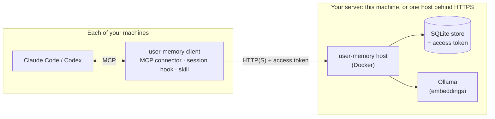

# user-memory

Long-term memory for Claude Code, Codex and other MCP agents. It keeps your
stated preferences, decisions, goals and context, plus grounded observations
and tentative patterns, and shares them with all your agents and machines.
It is self-hosted: one SQLite store on a server you run, or on your own
machine, with no model gateway, transcript scraping or model training. It
runs on macOS, Linux and Windows (preview).

- **Your rules in every session.** Your standing rules (explicit, confirmed,
  global preferences, constraints and values) are written into each client's
  instruction file: `~/.claude/rules/user-memory.md` for Claude Code, a marked
  block in `~/.codex/AGENTS.md` for Codex. Each line is a short title; agents
  read the full memory before applying it.
- **An index at session start.** A session hook gives the agent the
  conversation's origin, the projects it loads and an index of everything
  else in scope: project rules and other memories, one titled line each.
- **Changes reach running sessions.** When another session or machine changes
  memory, the next prompt in a running session carries a short notice of what
  changed.
- **Agents record through it.** When you state a preference or decision, or an
  agent learns something about a project's code that its repository does not
  state, the agent records it in user-memory (with a title and the
  conversation it came from), not in its client's own memory files.
- **Grounded, without duplicates.** Explicit statements need your
  confirmation, observations need evidence, and patterns need two
  independent conversations and stay tentative. Saying something again
  confirms it, changing your mind replaces it, and near-duplicates are
  caught by keywords and by meaning.
- **Global and per-project memory.** One project key covers every clone of a
  repository, or a folder without git; project exceptions never override
  your global preferences.
- **Yours to manage.** Forget everything one chat taught, review and merge
  on request, export and import, daily backups, and upgrades that back the
  store up first.

Agents use the MCP tools `index`, `read`, `search`, `record`, `update`,
`forget`, `link`, `review`, `export` and `import`. Forget, update and import
change memory only on your explicit request, and a global memory needs your
yes.

## How it fits together



- **The server** (`user-memory host`) owns the memories. It enforces the
  rules (provenance, duplicate checks, approval for changes) and serves the
  MCP tools.
- **The client** is the same binary on each machine. Setup registers it with
  your agents, adds the session hooks and installs a skill with playbooks
  for the rare workflows: review, backup, forgetting a chat, upgrading.

| Way to run it | For | Guide |
|---|---|---|
| Docker on this machine (the default) | One machine. | [Docker on this machine](docs/server.md#docker-on-this-machine) |
| Native on this machine | One machine, without Docker. | [Native on this machine](docs/server.md#native-on-this-machine) |
| A shared server behind HTTPS | One memory across all your machines and agents. | [A shared server](docs/server.md#a-shared-server-behind-https) |

## Install

```bash
curl -fsSL https://github.com/l7aromeo/user-memory/releases/latest/download/install.sh | sh
```

The installer asks whether you already have a memory server. If not, it sets
one up on this machine, in Docker or as a local store. Then it installs the
client to `~/.local/bin/user-memory`, connects every Claude Code and Codex it
finds, and runs `user-memory doctor`.

On Windows, in PowerShell:

```powershell
irm https://github.com/l7aromeo/user-memory/releases/latest/download/install.ps1 | iex
```

It installs to `%LOCALAPPDATA%\Programs\user-memory\bin` and adds that
folder to your PATH ([install on Windows](docs/install.md#install-on-windows)).

After installing, restart Claude Code and Codex once. In Codex, run `/hooks`
and choose **Trust** for user-memory's two hooks.

Run the same command again to upgrade. To remove it, keeping your memories:

```bash
curl -fsSL https://github.com/l7aromeo/user-memory/releases/latest/download/uninstall.sh | sh
```

On Windows:

```powershell
irm https://github.com/l7aromeo/user-memory/releases/latest/download/uninstall.ps1 | iex
```

## Documentation

- [Install, upgrade and uninstall](docs/install.md): the installer's choices
  and options, what setup changes, upgrades (including the titles step from
  0.3) and rolling them back, and removing it.
- [How it works](docs/how-it-works.md): memories, scope, titles, your rules
  in instruction files, the index at session start and change notices.
- [Projects](docs/projects.md): which memories load where, folders without
  git, folders of repositories, conversation links and moving a project.
- [Command line](docs/cli.md): every command you can run yourself.
- [Running the server](docs/server.md): the Docker server, the native
  store, a server shared behind HTTPS, the access token, semantic search,
  upgrades and backups.
- [Troubleshooting](docs/troubleshooting.md): what each message means and
  what to do.
- [Privacy](docs/privacy.md): what is stored, where the token lives, and what
  leaves your machine.
- [Reference](docs/reference.md): the memory model, duplicates, the MCP
  tools, hooks and skill, project identity, the CLI, search, configuration
  and storage, in full.

## Develop

user-memory is a Rust program; `just check` runs what every change must
pass. [Contributing](CONTRIBUTING.md) has what a change needs,
[development](docs/dev/development.md) the tests and tools, and
[releasing](docs/dev/releasing.md) how a release is made. Report security
issues privately, as [SECURITY.md](SECURITY.md) says.

## License

Licensed under either of [MIT](LICENSE-MIT) or
[Apache-2.0](LICENSE-APACHE), at your option. The binaries include
open-source components under their own licenses, listed in
`THIRD_PARTY_NOTICES.txt` in each release.
