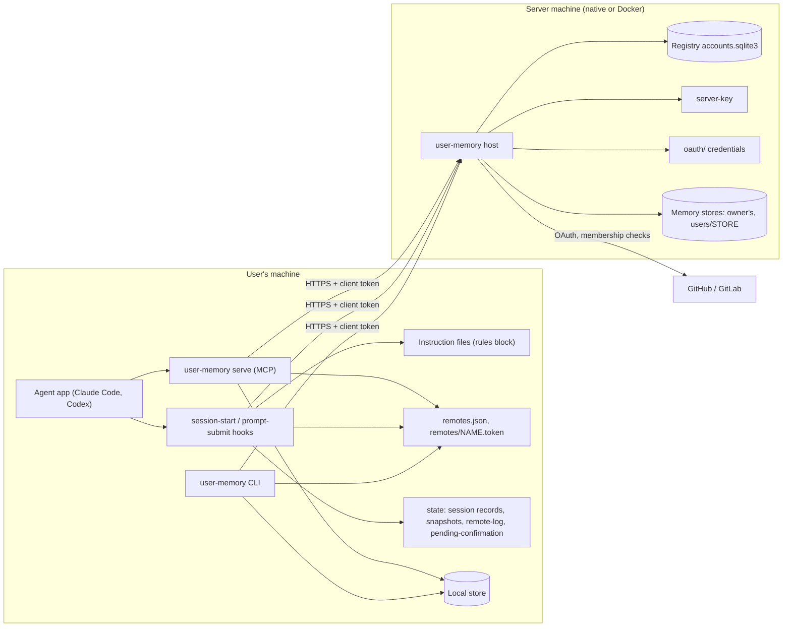
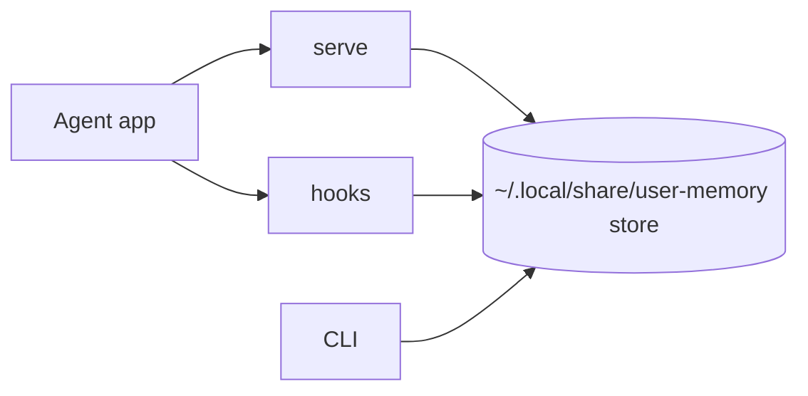
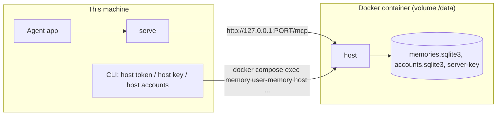
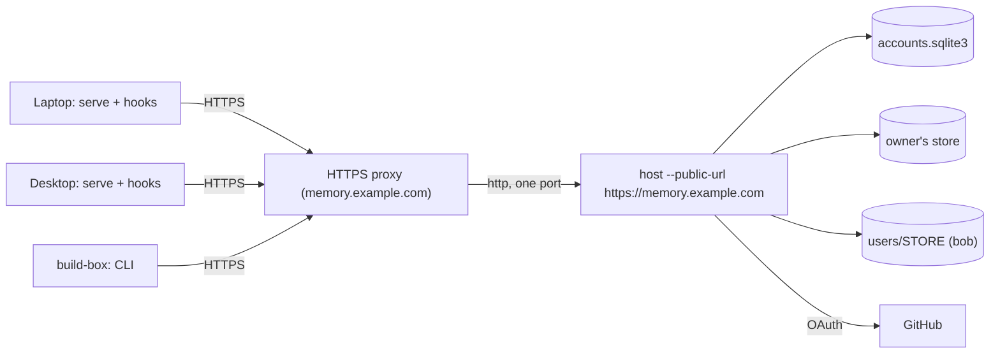
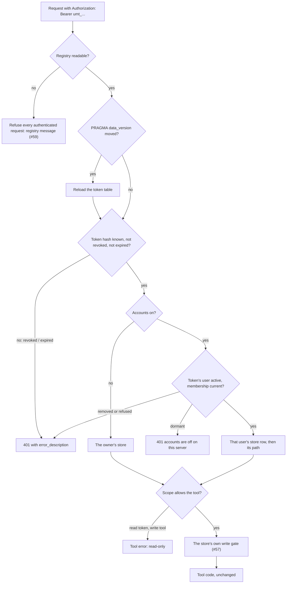

# 01 Architecture

The parts of user-memory after the work in this design, where each one
runs, and which part talks to which. Today's code (main at 48c5be3) is
the starting point; each change names the issue that makes it.

See [02-data-model.md](02-data-model.md) for the tables and files,
[03-identity-and-auth.md](03-identity-and-auth.md) for keys, tokens and
sign-in, and [05-remotes-and-switching.md](05-remotes-and-switching.md)
for remotes.

## One binary, many roles

user-memory is one binary. What it does depends on the command:

| Role | Command | Runs where | Today | After this design |
|---|---|---|---|---|
| MCP server for one agent | `user-memory serve` | the user's machine, started by the agent app | stdio MCP on the local store, or a bridge to a remote server when `USER_MEMORY_URL` is set | the same, with the remote chosen by resolution (#60) and pinned for the session (#61) |
| Session hooks | `user-memory session-start`, `user-memory prompt-submit` | the user's machine, run by the agent app | read rules and notices from the store or remote | also check the server's key (#58), record the session's remote (#61), apply a typed confirmation (#62) |
| Command line | `user-memory record`, `search`, `remote …`, `login`, `account …` | the user's machine | local store, or the remote from the receipt | the same, plus the `remote`, `login`, `logout` and `account` commands (#60, #61, #64, #67) |
| Shared server | `user-memory host` | a server machine, natively or in the installer's Docker container | HTTP MCP behind one token file | per-client tokens (#48) in a registry (#59), a server key (#58), optional accounts with one store per user (#63) |
| Server administration | `user-memory host token …`, `host key …`, `host provider …`, `host accounts …`, `host users …`, `host allow …`, `host invite …` | the server machine | none | new (#48, #58, #63, #64, #66, #68) |
| Installer's Docker server | hidden `user-memory server …` | the machine that runs the installer | builds and runs the container | unchanged; `host …` commands reach the container through the Compose helper (#75) |

Only two hooks exist today: SessionStart and UserPromptSubmit
(`src/setup/hooks.rs`, `HOOKS`). Nothing in this design adds a third; see
open point 1.

## Components

- **Agent app.** Starts `serve` as its MCP server and runs the two hooks.
  Claude Code and Codex on one machine share one configuration and one
  active remote (#61).
- **`serve`.** Answers the MCP tools. With a local store it opens the store
  itself. With a remote it forwards each call over HTTPS with the remote's
  client token. It resolves the server once, at its start (`src/setup.rs`,
  `configured_remote`), and keeps it for its lifetime, which is the
  session's.
- **Hooks.** SessionStart writes the rules into the instruction files and
  prints the index and notices. UserPromptSubmit prints notices and, after
  #62, applies a typed confirmation. Each run resolves the server again,
  which is why #61 records the session's remote at session start.
- **CLI.** The user's own interface: memory commands, setup, doctor, and
  the new `remote`, `login`, `logout` and `account` commands.
- **Client files.** `~/.config/user-memory/remotes.json` (version 1) with
  the active remote, each remote's URL, key pin and history, account,
  client name and token path; `~/.config/user-memory/remotes/<name>.token`,
  owner-only; `~/.local/state/user-memory/remote-log` and
  `~/.local/state/user-memory/pending-confirmation` (#60, #62).
- **`host`.** The shared server. It proves its key at
  `GET /.well-known/user-memory`, authenticates each request by client
  token, routes it to the token's store, and serves `/mcp`, `/export` and
  `/import`. With accounts it also brokers sign-in (`/auth/*`, `/login`),
  serves `/connect` for invites and takes provider hooks at `/hooks/*`.
- **Registry.** `<data>/accounts.sqlite3`, outside every memory store. In
  v0.10.0 it holds `client_tokens` and `settings` (#59). #63 adds `users`,
  `identities`, `stores`, `client_tokens.user` and the accounts settings;
  #68 adds `invites`. Each by the registry's own migrations.
- **Server key.** `<data>/server-key`, Ed25519, owner-only (#58).
- **Memory stores.** One SQLite store per user once accounts are on: the
  owner's keeps its path, new users get `users/<store id>/` (#63). Each has
  its own write gate, held connection and vector cache slot (#57).
- **Provider credentials.** `<data>/oauth/`: the OAuth client secret, the
  GitHub App private key `<data>/oauth/<id>.key`, GitLab tokens (#64, #66).

## Deployment shapes

### Native, local store

No server. `serve`, the hooks and the CLI open the store on this machine.
Nothing in this design changes it: a local-only install creates no
`remotes*` file (#60), and `local` is the reserved remote name for this
store.

### The installer's Docker server on this machine

The installer runs `host` in a container and connects this machine's
agents to it at `http://127.0.0.1:<port>/mcp`. The store, the registry and
the server key live in the container's volume (`/data`). On this machine,
`host …` administration commands run in the container through the Compose
helper (#48, #75).

- The healthcheck asks `/` without a token once #48 lands, so
  `retire-shared` can't break it.
- The installer pins the server key straight from the volume (#68).

### A shared server for several machines

`host` runs on a server machine behind an HTTPS proxy that forwards `/mcp`,
`/export`, `/import`, `/.well-known/user-memory`, and with accounts
`/auth/*`, `/login`, `/connect` and `/hooks/*` (#64). Each client machine
has its own token (#48). With accounts on, each person has their own store
and signs in (#63, #64).

- The proxy terminates TLS. The server builds redirect URIs only from
  `--public-url` (`USER_MEMORY_PUBLIC_URL`), never from `Host` or
  `X-Forwarded-*` (#64).
- The server key proves the server behind the proxy, so a proxy that
  intercepts TLS can't stand in for it (#58).

## A request through the server

Every authenticated request, MCP or transfer, goes the same way.

Error paths:
- **Registry unreadable:** every authenticated request is refused, the
  shared file included, with
  ``The server's token registry /data/accounts.sqlite3 cannot be read (file is not a database). Move it aside and issue each client a new token with `user-memory host token add`.``
  (#59).
- **Unknown, revoked or expired token:** 401 with
  `error_description="revoked" | "expired"`; the client prints #48's
  messages. With accounts, `"sign in required"` is added (#48).
- **Accounts turned off and the user isn't the kept one:** 401 with
  `error_description="accounts are off on this server"` (#63).
- **Membership lapsed past `MEMBERSHIP_GRACE`:** refused until a check
  succeeds, with a message naming the org (#66).
- **Read-only token and a write tool:** a tool error, or 403 on `/import`,
  with #48's read-only message.

## Where the client resolves its server

`serve` and the hooks take the first of (#60):
1. `USER_MEMORY_URL` with `USER_MEMORY_TOKEN_FILE`, plus an optional
   `USER_MEMORY_SERVER_KEY`;
2. `USER_MEMORY_DB`;
3. the active remote in `remotes.json`;
4. the receipt's remote, before migration;
5. the local store.

After #61, a running session doesn't resolve again: the hooks use the
session's record, written at session start, and `serve` keeps the server
it resolved at its own start.

## What stays the same

- A native install with a local store, and a single-token server that
  never turns accounts on, see no change: the same files, store schema,
  registrations, messages and doctor lines, apart from doctor's server
  line, which names the server (#56, #60).
- The MCP tools and their fields. The tool code runs unchanged behind the
  routing (#63).
- The store format. Nothing in this design changes a memory store's
  schema; the registry has its own versions (#59).

## Open points

1. **No stop hook.** #61 says "The MCP process, and the prompt and stop
   hooks, use that record". Today only SessionStart and UserPromptSubmit
   exist (`src/setup/hooks.rs`, `HOOKS`). Edit #61 to say "the MCP process
   and the prompt hook", or add a Stop hook as its own issue.
2. **Which session record `serve` reads.** The hooks get a session id in
   their payload; `serve` doesn't. #61 says the MCP process uses the
   session's record, not `active`. As built today, `serve` resolves once at
   its own start, which is enough when nothing switches between the app
   starting `serve` and running SessionStart. A switch in that short window
   would leave `serve` and the hooks on different servers, and neither can
   see the other's choice. Options:
   - accept the window, which needs a confirmed switch to land within
     the moments between the two starts, and say so in #61;
   - have `serve` write the remote it resolved to the state folder, keyed
     by something the hooks can also derive for the same session, and
     have SessionStart compare. What key both sides share has to be
     checked for each client when building.

   Edit #61 to say which. See
   [05-remotes-and-switching.md](05-remotes-and-switching.md), open point 4.
