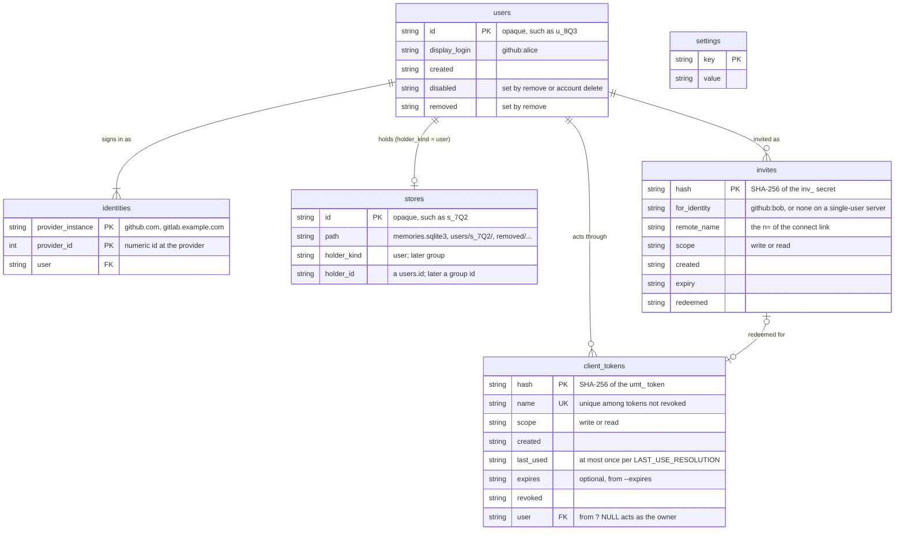
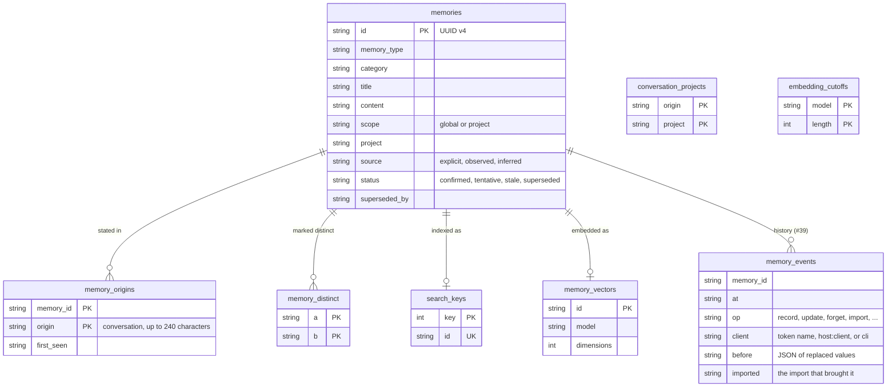
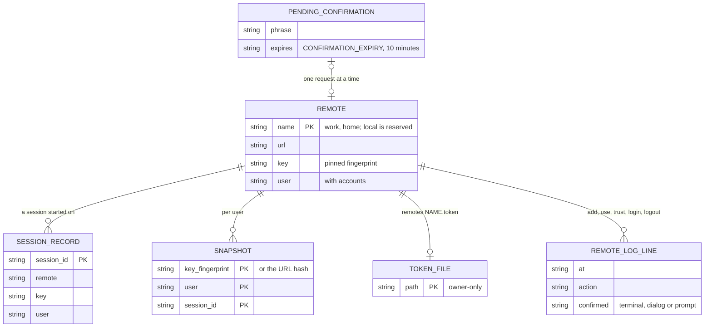
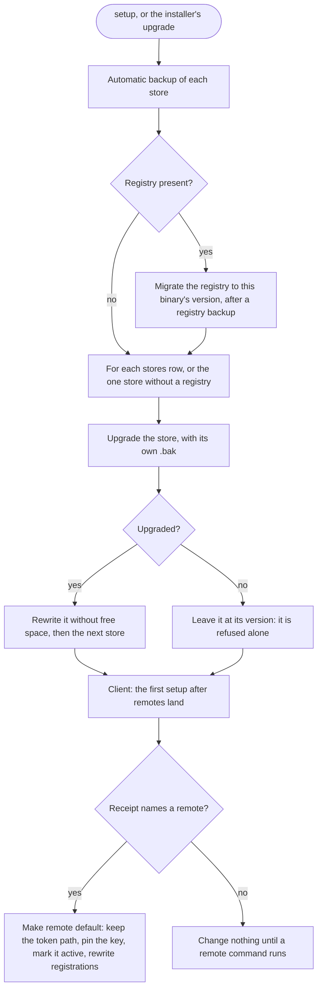
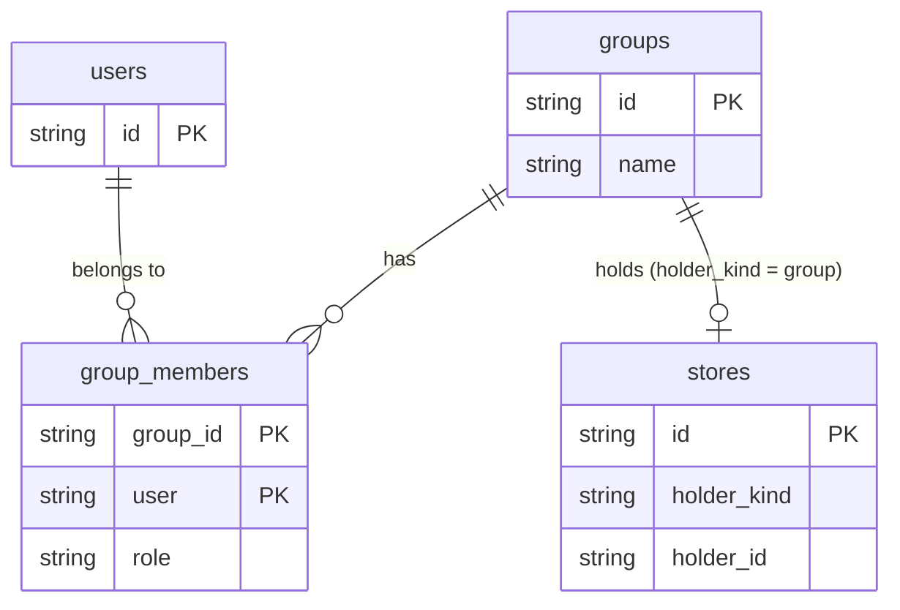

# 02. Data model

What the accounts and switching work stores, and where: the server's data
folder, the registry, each memory store, and the files on a client
machine. Each table, file and field names the issue that adds it. Where
this file and an issue differ, the issue wins until the edit listed under
[Open points](#open-points) is made.

Related: [01-architecture.md](01-architecture.md) for the components that
read these, [03-identity-and-auth.md](03-identity-and-auth.md) for how
tokens and identities are made, [04-accounts-mode.md](04-accounts-mode.md)
for the operations on users and stores, and
[07-state-machines.md](07-state-machines.md) for the states these rows
move through.

## Principles

- **Two kinds of database, never mixed.** The registry,
  `<data>/accounts.sqlite3` (#59), holds who may use a server and how.
  Each memory store holds one holder's memories and nothing about
  accounts. Restoring a memory store never touches the registry, and
  restoring the registry revokes every client token (#63).
- **A store doesn't know whose it is.** No memory table gains an owner
  column. The registry's `stores` row says who holds a store, and no code
  decides it from the path (#63).
- **No secrets in the registry.** It keeps token hashes (#48), invite
  hashes (#68) and the paths of credential files (#66). Provider secrets
  and the server key are files of their own, owner-only.
- **No memory text outside the stores.** The registry, the client's state
  files and doctor's per-store lines (#70) hold ids, counts, sizes,
  hashes and fingerprints, never a memory's words.
- **Each database has its own schema line.** The store's `SCHEMA_VERSION`
  (6 today) and the registry's version (1 from #59) move separately, each
  with snapshots and tested forward migrations.

## Where the data lives

### The server's data folder

`<data>` is the folder that holds the server's `--db`: `/data` in the
installer's Docker server.

| Path | What | Added by | Created when |
|---|---|---|---|
| `memories.sqlite3` | The owner's store. Its path never changes, so turning accounts on moves no file. | today | `host` starts |
| `backups/` | That store's automatic backups, 7 kept | today, #52 | the first backup |
| `access-token` | The shared token file (`--token-file`); acts as the owner (#63) until `host token retire-shared` (#48) | today | `host` starts |
| `accounts.sqlite3` | The registry | #59 | the first `host token add`, `host accounts enable` or `host invite`, never by `host` starting |
| `accounts-backups/` | The registry's daily backups, 7 kept | #63 | the first registry backup |
| `server-key` | The server's Ed25519 key, owner-only | #58 | the first `host` start or `host key show` |
| `oauth/` | Provider client secrets, and the GitHub App's private key as `oauth/<id>.key` | #64, #66 | `host provider add` |
| `users/<store id>/` | A new user's store, with its own `backups/` | #63 | the user's first sign-in |
| `removed/<store id>-<date>/` | A removed user's store, kept until `purge` | #63, #67 | `host users remove`, `account delete`, `account merge` |

```text
/data/
  memories.sqlite3          owner's store (unchanged path)
  backups/                  its automatic backups
  access-token              shared token file
  accounts.sqlite3          registry
  accounts-backups/         registry backups
  server-key                Ed25519 key
  oauth/github.secret       provider secret (name per provider id)
  oauth/github.key          GitHub App private key, for membership checks
  users/s_7Q2…/memories.sqlite3
  users/s_7Q2…/backups/
  removed/s_4KD…-2026-11-30/memories.sqlite3
```

### A client machine

| Path | What | Added by |
|---|---|---|
| `~/.local/bin/.user-memory.json` | The receipt: what setup chose. Its remote becomes the remote `default` at the first setup after the upgrade. | today, migrated by #60 |
| `~/.config/user-memory/client-token` | Today's token file. After the migration it stays where it is, as `default`'s token path. | today, #60 |
| `~/.config/user-memory/remotes.json` | Remotes, version 1 | #60 |
| `~/.config/user-memory/remotes/<name>.token` | One client token per remote, owner-only, never inside the JSON | #60 |
| `~/.local/state/user-memory/remote-log` | Every add, use, trust, login and logout, with the time and how it was confirmed | #60 |
| `~/.local/state/user-memory/pending-confirmation` | One pending request, expiring after `CONFIRMATION_EXPIRY` (10 minutes) | #62 |
| `~/.local/state/user-memory/sessions/` | Session snapshots, kept per server key and user | today, rekeyed by #61 |
| `~/.local/state/user-memory/rules-seen-<store key>.json` | The rules session start last showed, by id and fingerprint | #42 |
| `~/.local/state/user-memory/instructions/` | Write records of the instruction files | today |
| `.user-memory`, `.user-memory-key` | Project files in a user's folders; unchanged by a switch (#61) | today |

A local-only install that never runs a `remote` command gains none of the
`remote*` files (#56, #60).

## The registry

One SQLite file per server, `<data>/accounts.sqlite3`, owner-only
(`src/private.rs`). It has its own migrations: #59 makes version 1, and
#63 and #68 each add "the next version after the one in use".



`settings` stands alone: it holds server-wide values, not rows of a user.

### Tables, by issue

| Table | Columns | Version | Issue |
|---|---|---|---|
| `client_tokens` | hash, name, scope, created, last used, optional expiry, revoked | 1 | #59, #48 |
| `settings` | key, value; v0.10.0 uses only `shared_file_retired` | 1 | #59 |
| `users` | id (opaque), display login, created, disabled, removed | next | #63 |
| `identities` | provider instance, numeric provider id, user; the pair is unique | next | #63, written by #64, #65, #67 |
| `stores` | id, path, holder kind (`user`, later `group`), holder id | next | #63 |
| `client_tokens.user` | the user a token acts as | next | #63 |
| `settings` keys | accounts mode, providers (without secrets), allow rules, the membership credential's path | next | #63, #64, #66 |
| `invites` | hash, who it's for, remote name, scope, created, expiry, redeemed | next | #68 |

### What the server reads, and how often

- **Per request:** `PRAGMA data_version` on its own connection. The token
  table, and with accounts the users, stores and allow rules, are held in
  memory and reloaded only when another connection committed (#59). The
  server's own last-use writes don't move it.
- **A request's path:** the bearer token's SHA-256 finds a
  `client_tokens` row; its `user` (or the owner, when NULL) finds the
  user's `stores` row; its `path` is the store the request opens (#63). See
  [04-accounts-mode.md](04-accounts-mode.md#routing-a-request).
- **Never** the path to decide the holder: doctor, backup, restore, repair
  and migrate read `stores` (#63).

### Who writes which rows

| Writer | Rows |
|---|---|
| `host token add`, `revoke`, `retire-shared` | `client_tokens`, `settings.shared_file_retired` (#48) |
| `host accounts enable`, `disable` | `settings` accounts mode; the owner's `users`, `identities` and `stores` rows on enable (#63) |
| `host users remove`, `restore`, `purge`, `link` | `users.disabled`, `users.removed`, `stores.path`, `client_tokens.revoked`, `identities` (#63) |
| `host allow add`, `remove` | `settings` allow rules (#63) |
| `host provider add`, `remove` | `settings` providers, and the files in `oauth/` (#64, #66) |
| `host invite`, `/auth/invite` | `invites`; a redeemed invite adds a `client_tokens` row (#68) |
| sign-in (`/auth/token`) | `users`, `identities` and `stores` for a new user; a `client_tokens` row (#64) |
| `account link`, `unlink`, `merge`, `delete`, `clients revoke` | `identities`, `users`, `stores.path`, `client_tokens.revoked` (#67) |
| `logout`, `remote remove`, uninstall | `client_tokens.revoked` through `DELETE /auth/token` (#60, #64, #71) |
| a restored registry | every `client_tokens` row revoked before the copy is swapped in (#63) |

## A memory store

Every store, the owner's and each user's, has the same schema, at the same
version: one `migrate` upgrades them all (#56, #70). Accounts change no
memory table (#63, #70).



The diagram shows each table's keys and the columns this design reads, not
every column. The full schema is in `src/memory/schema.rs` and
`src/memory/index.rs`; `search_words`, `search_pending`, `search_state` and
`search_changes` are the keyword index's tables.

### Store changes on the way, outside this design

| Change | Store impact | Issue |
|---|---|---|
| Memory history | `memory_events` and its triggers; `SCHEMA_VERSION` bump | #39 (v0.10.0) |
| Import provenance | `import` events naming each import; no table of its own | #43 (v0.10.0) |
| Keyword index with stored content | `search_words` changes; `SCHEMA_VERSION` bump | #87 (v0.10.0) |
| Export source | an export file field, not a table | #69 |

The accounts work needs none of them. Two meet it:
- `memory_events.client` names the token (#39). With accounts it can also
  name the user who made the change; #56 lists this "actor" field as later
  work.
- `account merge` imports one user's store into another's and is recorded
  as an import (#43, #67), so `forget --import ID` can undo it while the
  events are kept.

## Client files

### `remotes.json`, version 1 (#60)

```json
{
  "version": 1,
  "active": "work",
  "remotes": {
    "work": {
      "url": "https://memory.example.com/mcp",
      "key": "SHA256:4f2c…",
      "key_history": [
        {"key": "SHA256:1d8e…", "until": "2026-12-01"}
      ],
      "account": {"user": "u_8Q3…", "login": "github:alice"},
      "client": "laptop",
      "token_file": "~/.config/user-memory/remotes/work.token",
      "added": "2026-11-02T14:02:00Z"
    }
  }
}
```

- The token is never inside the JSON (#60). `token_file` names the file;
  for `default`, made by the migration, it's today's `client-token` path,
  which stays where it is.
- `local` is a reserved name for this machine's store and has no entry
  (#60).
- `active` changes in one rename, so a reader sees the old file or the
  new one, never a part (#61).
- A server without accounts has no `account` (#60's doctor line then
  shows no "signed in as").

### Session state (#61)

Session start records each session's remote, key and user in the
session's state, and the MCP process and the prompt hook read that
record, not `active` (#61); `serve` records the remote it resolved, and
session start compares the two. Snapshots are keyed by the server key's
fingerprint and the user id, or the URL hash for a server without a key,
and are kept when switching away (#61).



These are files, not tables; the diagram shows what refers to what.

### What uninstall removes (#71)

For each remote it revokes the token when the server can be reached, then
deletes the token file; an unreachable remote gets a `Left:` line. Then it
deletes `remotes.json`, `remote-log` and `pending-confirmation`, as well as
the state folder it removes today.

## Migrations



Error paths:
- **A registry with a newer schema version** is refused with a message to
  upgrade the binary, as for a memory store (#59). Nothing is served.
- **A damaged registry** refuses every authenticated request, the shared
  file included, with #59's message naming
  `user-memory host token add`.
- **One store fails its upgrade:** it stays at its version and is refused
  alone, with today's upgrade message naming it; the others are upgraded
  and served (#70).
- **The rewrite without free space can't get the store** while another
  writer holds it past the usual wait: it's skipped with a note, and the
  next setup or `migrate` tries again (0.9.2).
- **The client migration finds no reachable server:** see
  [Open points](#open-points); #60 doesn't say whether `default` is made
  without a pin.
- **A downgrade:** an older binary ignores `accounts.sqlite3` and accepts
  only the shared file (#59); after `retire-shared` that file holds a
  token nobody has (#48). An older binary refuses a store with a newer
  `SCHEMA_VERSION`.

### Version lines

| Line | Today | Changes |
|---|---|---|
| Store `SCHEMA_VERSION` | 6 | #39 and #87 in v0.10.0; none from accounts |
| Registry version | none | 1 (#59), then #63's tables, then #68's `invites`, each "the next version after the one in use" |
| Export `format_version` | 2 | none: `history` (#39) and `source` (#69) are optional top-level keys that import ignores |
| `remotes.json` `version` | none | 1 (#60) |

## Room for groups

Groups come later (#56). The model leaves room without building them:

- `stores.holder_kind` takes `group` beside `user`, and `holder_id` then
  names a group (#63).
- An export's `source` uses the same field with `kind: "group"` (#69).
- Every store has the same schema, so a group's store is an ordinary
  store; nothing in a memory row says whose it is.
- One `migrate` and one server-wide embedding setting cover a group's store
  too (#56).

What a group would add, as a sketch only:



Rules from a group's store stay in the session index and never enter
instruction files unless the user adopts one (#56). Duplicate checks across
a user's and their groups' stores, and converting a store several people
shared into a group's, are later work (#56).

## Open points

Resolved by the user's decisions, and now in the issues:

1. Membership checks: `identities.checked_at` and `check_result`, by #66's
   own registry migration.
2. `purge` deletes the `stores` row and the identities, and keeps the
   `users` row with `removed` set (#63).
3. Stores live at `users/<store id>/memories.sqlite3`; store ids start
   `s_`, user ids `u_` (#63).
4. Allow rules and providers are one `settings` row each, `allow:<rule>`
   and `provider:<id>` (#63).
5. `client_tokens.user` is empty for tokens that act as the owner, so they
   follow a change of owner (#63).
6. #39's actor note names #63.
7. #42's state file is keyed as #61 keys snapshots.
8. The client migration makes `default` without a pin when the server is
   unreachable, and pins at first contact (#60).
9. The registry gets the same quiet-hour and shutdown backup checks as
   memory stores (#63).
