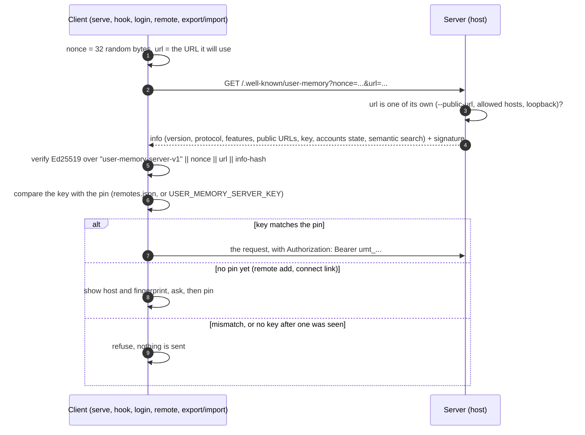
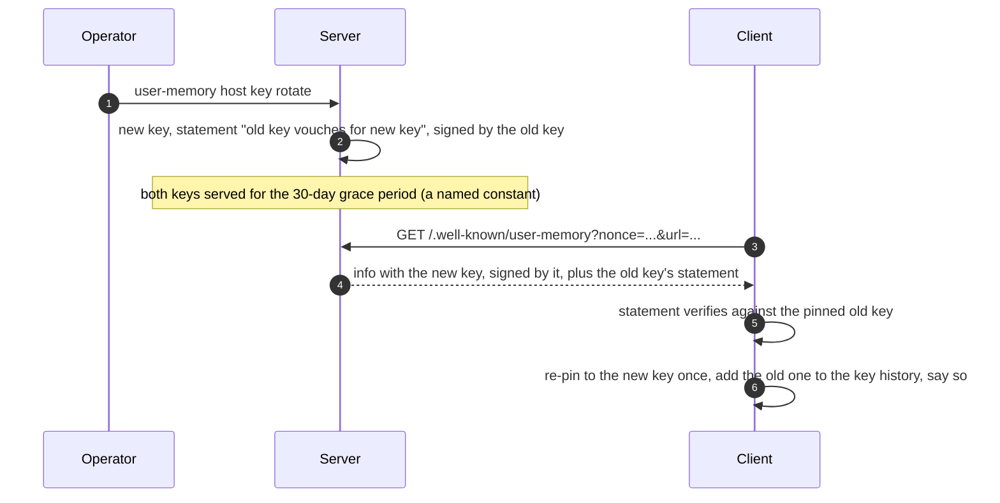
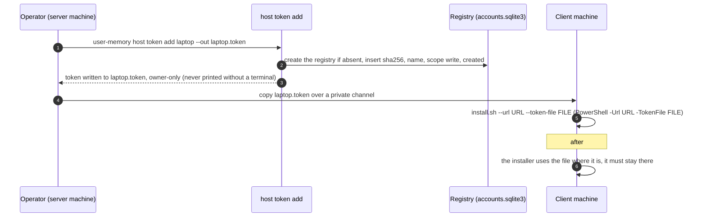
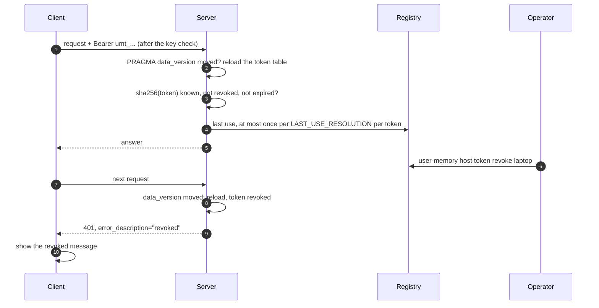
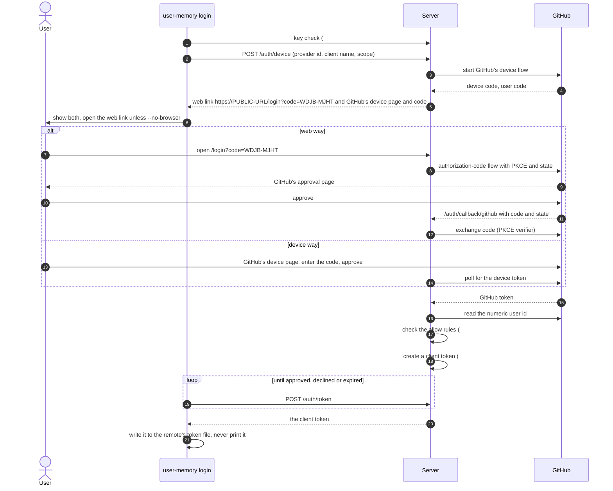
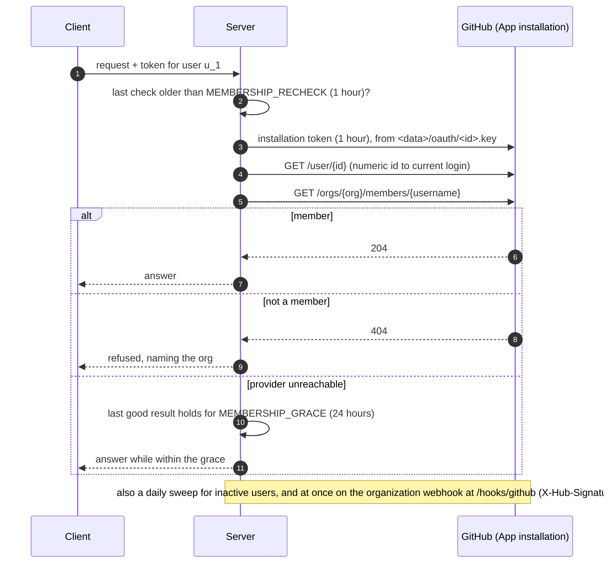
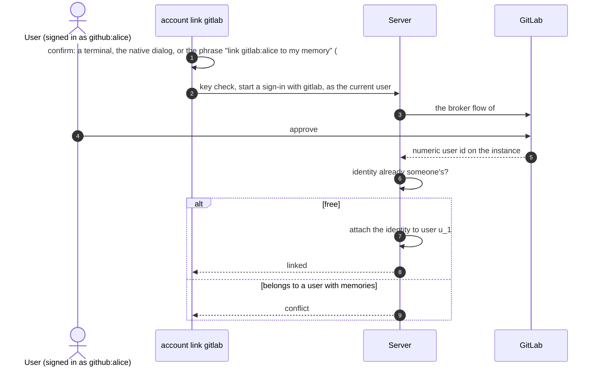
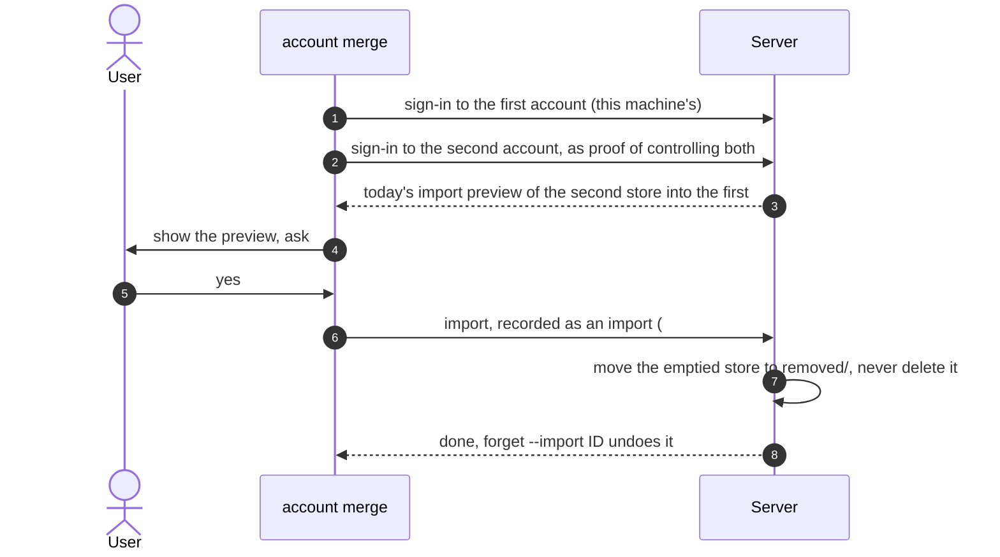

# 03 Identity and authentication

How a client knows it reached the right server, how a server knows which
client and person is calling, and how people sign in. Covers [#58](https://github.com/l7aromeo/user-memory/issues/58), [#48](https://github.com/l7aromeo/user-memory/issues/48),
[#64](https://github.com/l7aromeo/user-memory/issues/64), [#65](https://github.com/l7aromeo/user-memory/issues/65), [#66](https://github.com/l7aromeo/user-memory/issues/66) and [#67](https://github.com/l7aromeo/user-memory/issues/67).

Tables and files are in [02-data-model.md](02-data-model.md). Switching
between servers is in [05-remotes-and-switching.md](05-remotes-and-switching.md).
Confirmation of the sensitive commands is in
[06-confirmation-and-approval.md](06-confirmation-and-approval.md). The
threat model is in [09-security.md](09-security.md).

## The three credentials

| Credential | Held by | Proves | Never |
|---|---|---|---|
| Server key, Ed25519, `<data>/server-key` ([#58](https://github.com/l7aromeo/user-memory/issues/58)) | the server | to a client, that it is the server the client pinned | leaves the server; a memory export never carries it |
| Client token, `umt_` + 52 base32 characters ([#48](https://github.com/l7aromeo/user-memory/issues/48)) | one machine, in its remote's token file | to the server, which machine and (with accounts) which user calls | printed, logged, sent to another server, or stored by the server other than as its SHA-256 |
| Provider credential: the OAuth client secret, a GitHub App key, GitLab tokens ([#64](https://github.com/l7aromeo/user-memory/issues/64), [#66](https://github.com/l7aromeo/user-memory/issues/66)) | the server, in `<data>/oauth/` | to GitHub or GitLab, that the server is the registered app | reaches a client; a user's own provider token is discarded at sign-in |

The client checks the server before it sends a token; the server checks
the token before it touches a store. A provider never sees a client token,
and a client never sees a provider credential.

## Server key and pinning ([#58](https://github.com/l7aromeo/user-memory/issues/58))

### Creating and showing the key

- `host` creates `<data>/server-key`, owner-only, on its first start, as
  does `host key show` (`/data/server-key` in Docker).
- Fingerprints are `SHA256:<base64>`, as SSH shows them.
- Whole-data-folder backups carry the key; memory exports don't.

### The proof



- Every process checks before sending a token: `serve`, each hook,
  `login`, the `remote` commands, export and import.
- The URL is inside the signature, so a relay at another address can't
  pass the server's answer on.
- For the prompt hook, the check is measured against `PROMPT_LIMIT`. If
  it's too slow, the result is cached for the session, keyed by session
  id, never for the whole process.

Error paths:
- **Mismatch, in a terminal:**
  ```output
  The memory server at https://memory.example.com is not the one you added as "work".
    Key you trusted: SHA256:4f2c…  (since 2026-11-02)
    Key it shows now: SHA256:9a1b…
  Someone may be intercepting the connection, or the server's operator replaced its key.
  Nothing was sent to it. Ask the operator for the server's fingerprint
  (`user-memory host key show` on the server). If it matches the new key, run:
    user-memory remote trust work SHA256:9a1b…
  ```
- **Mismatch, in a session:**
  ```output
  Memory is paused: the server "work" no longer proves the identity you trusted. The user needs to check it in a terminal (user-memory remote show work).
  ```
- **A server with no key** (older than [#58](https://github.com/l7aromeo/user-memory/issues/58)): recorded as having no key.
  Once a key has been seen, its absence is a mismatch.
- **A URL the server doesn't call its own:** it doesn't sign, which the
  client treats as a mismatch.
- **Unreachable:** no token is sent; the caller reports the server as
  unreachable, as today (`User memory unavailable: …` in a session).

### Rotation



Error paths:
- **`host key rotate --no-chain`** (a compromised key): no statement, so
  every client sees a mismatch and its user decides with
  `user-memory remote trust`.
- **A client that first connects after the grace period:** no statement
  is served any more, so it sees a mismatch.
- **A rollback to a binary without keys:** the server stops proving a
  key, which counts as a mismatch, never as "skip the check".
- **A restored data folder** keeps the key; nothing changes for clients.

## Client tokens ([#48](https://github.com/l7aromeo/user-memory/issues/48), in the registry of [#59](https://github.com/l7aromeo/user-memory/issues/59))

### Issuing a token without accounts



- On the installer's Docker server, the command runs in the container
  through the Compose helper ([#75](https://github.com/l7aromeo/user-memory/issues/75)). The container writes the token to a
  temporary file in its volume, the host copies it to `--out`
  (owner-only) the way `copy_token` does (`src/server.rs:655`), and
  deletes the container's copy. A copy left by an interrupted `add` is
  deleted by the next `host token` command and at server start.
- A connect link replaces the copied file ([#68](https://github.com/l7aromeo/user-memory/issues/68)), see
  [05-remotes-and-switching.md](05-remotes-and-switching.md).

Error paths:
- **No `--out` and stdout isn't a terminal:** refused, so the token never
  lands in a tool's output.
- **A name already in use:** refused; revoke it first.
- **On a client of another server:**
  ```output
  https://memory.example.com/mcp is a memory server on another machine; run user-memory host token there.
  ```

### Using and revoking a token



Error paths, all shown wherever the client meets the 401: doctor's probe
(`src/remote.rs:106`), the hooks' tool calls (`src/remote.rs:126`), the
stdio bridge, and export and import (`src/remote/transfer.rs:238`):
- **Revoked:**
  ```output
  The memory server at https://memory.example.com/mcp revoked this machine's token. Ask its operator for a new token file, then run the installer with --url https://memory.example.com/mcp --token-file FILE.
  ```
- **Expired after 90 days unused, or past `--expires`:**
  ```output
  This machine's token for https://memory.example.com/mcp expired after 90 days unused. Ask its operator for a new token file, then run the installer with --url https://memory.example.com/mcp --token-file FILE.
  ```
- **A read-only token and a write** (`record`, `update`, `forget`,
  `import` and its preview, `review` with `keep`): a tool error, and 403
  on `/import`:
  ```output
  This machine's token for https://memory.example.com/mcp is read-only; this needs a token with write access from the server's operator.
  ```
- **With accounts ([#63](https://github.com/l7aromeo/user-memory/issues/63)):** `"sign in required"` is added, and each
  message names `user-memory login` ([#64](https://github.com/l7aromeo/user-memory/issues/64)) instead.
- **A new client and an older server:** no `error_description`, so
  today's "Cannot connect to memory server; check endpoint and access
  token".
- **An unreadable registry:** every authenticated request is refused
  ([#59](https://github.com/l7aromeo/user-memory/issues/59)), see [01-architecture.md](01-architecture.md).

### The shared file

The shared file, `access-token` (`--token-file`), keeps working with write
access and no expiry, listed as `owner (shared file)`.
`user-memory host token retire-shared` gives this machine's client its own
token, replaces the file's token with an unknown one, and sets
`shared_file_retired`, so a rollback or a lost registry can't bring the
old token back ([#48](https://github.com/l7aromeo/user-memory/issues/48)).

Error paths:
- **On the installer's Docker server with the token healthcheck still in
  compose.yaml:** refused, asking to run the installer again first.

## Signing in with GitHub ([#64](https://github.com/l7aromeo/user-memory/issues/64))

The server brokers OAuth: RFC 8628 toward the client, OAuth toward the
provider. The provider's token never reaches the client.

### Setup

```
user-memory host provider add github [--id ID] [--base-url URL] --client-id ID --client-secret-file F [--app-id ID --private-key-file F]
user-memory host provider list | remove ID
```

The secret, and the app's private key for membership ([#66](https://github.com/l7aromeo/user-memory/issues/66)), go
owner-only into `<data>/oauth/`. The command prints the callback to
register, `https://<public-url>/auth/callback/<provider-id>`; "Enable
Device Flow" must be ticked on the app.

### The sign-in



- `user-memory login [REMOTE] [--name CLIENT] [--read-only] [--no-browser] [--provider ID]`.
- `user-memory logout [REMOTE]` revokes this machine's token
  (`DELETE /auth/token`), deletes it, and clears the rules block.
- A new sign-in tells the user's other machines at their next session
  start:
  ```output
  New sign-in to your memory: "build-box" with GitHub at 2026-11-02 14:02
  ```
  It names the client, the provider and the time, and no address.
- Pending sign-ins live in memory, and expire after 15 minutes or at a
  restart.

Error paths:
- **Declined:**
  ``Sign-in was declined at GitHub; this machine is not signed in. Run `user-memory login` to try again``.
- **Expired:** ``The sign-in timed out; run `user-memory login` again.``
- **Refused by the allow rules:**
  ```output
  github:bob may not sign in to memory server work; ask its operator to allow you (on the server: user-memory host allow add user:github:bob)
  ```
- **Too many pending sign-ins from one address:** the server answers
  `slow_down`:
  ```output
  Too many sign-ins were started from here; wait a minute, then run `user-memory login` again
  ```
- **No `--public-url`:** the web way isn't offered; the device way still
  works.
- **A proxy that drops `/auth/*`, `/login`, `/connect` or
  `/.well-known/user-memory`:** doctor and `host accounts status` name
  the dropped path.
- **A key mismatch at the first step:** nothing is sent, [#58](https://github.com/l7aromeo/user-memory/issues/58)'s message.
- **`login` without a terminal:** the native dialog ([#62](https://github.com/l7aromeo/user-memory/issues/62)); without a
  display, a pending request with the phrase `sign memory in as github:bob`.
- **A login rename on GitHub:** harmless; accounts use the numeric id.

## Signing in with GitLab ([#65](https://github.com/l7aromeo/user-memory/issues/65))

The same broker and client; only the provider differs.

```
host provider add gitlab [--id ID] [--base-url URL] --client-id ID --client-secret-file F
```

| | GitHub ([#64](https://github.com/l7aromeo/user-memory/issues/64)) | GitLab ([#65](https://github.com/l7aromeo/user-memory/issues/65)) |
|---|---|---|
| App | GitHub App, github.com or GitHub Enterprise Server | OAuth application on the instance; `--base-url` must be HTTPS |
| Identity | numeric user id | the instance and the numeric user id, such as `gitlab.example.com:42` |
| Scope | the app's | `read_user` |
| Device way | "Enable Device Flow" on the app | the device grant where the instance supports it (17.1 and later, with the `device_code` grant allowed; to confirm when building) |
| Without a device way | — | the web way only, and the CLI says why |

Two GitLab instances on one server are two provider ids and two separate
identity spaces.

## Re-checking membership ([#66](https://github.com/l7aromeo/user-memory/issues/66))

Org and group rules (`org:github:acme`, `group:…`) stay true after
sign-in by re-checking with the operator's credential. No user's provider
credential is stored.



GitLab uses a group access token (Reporter, `read_api`) on each group a
rule names, or an admin token on a self-managed instance, asks
`GET /groups/:id/members/all/:user_id`, takes a system hook at
`/hooks/gitlab` (verified with `X-Gitlab-Token`), and warns 30 days before
a group token expires.

Error paths:
- **A removed member:** refused at their next check, with a message
  naming the org.
- **Past `MEMBERSHIP_GRACE` with the provider still unreachable:** the
  user is refused until a check succeeds.
- **No credential:** rules are checked at sign-in and `account link`
  only, and `host allow add` and doctor warn:
  ```output
  org:github:acme is checked only when someone signs in: this server has no GitHub App credential to re-check membership. People who leave acme keep access until their tokens expire unused (90 days) or you remove them. To re-check, run `user-memory host provider add github --app-id … --private-key-file …`.
  ```
- **A webhook with a bad signature:** ignored.
- **GitLab's hosted service and group access tokens:** whether a paid
  plan is needed is unclear; confirm before the docs promise it.

## Linking identities and merging accounts ([#67](https://github.com/l7aromeo/user-memory/issues/67))

```
user-memory account show
user-memory account clients [revoke CLIENT]
user-memory account link PROVIDER
user-memory account unlink IDENTITY
user-memory account merge
user-memory account delete
```

### Linking a second identity



Error paths:
- **Conflict:**
  ```output
  That GitLab account is already user u_… with 212 memories. To join the two, sign in to both and run "user-memory account merge" (it moves the other user's memories into this one).
  ```
- **`unlink` of the last identity:** refused.
- **Allow rules** match any identity of the user, so a link can't widen
  access beyond the rules.

### Merging two accounts



The merge is recorded as an import ([#43](https://github.com/l7aromeo/user-memory/issues/43)),
so `forget --import ID` undoes it.

Error paths:
- **The second sign-in fails or is declined:** nothing is merged.
- **Declined at the preview:** nothing changes.
- **Unlinking after a merge:** it doesn't split the store, since nothing
  records which identity wrote a memory.

### Deleting an account

`account delete` offers an export first, then disables the account at
once; its memories wait in `removed/` until the operator purges them:

```output
Your account github:alice on memory server work is disabled; its memories wait for the operator, who can restore or delete them.
```

`link`, `unlink` and `delete` need confirmation at a terminal or in the
native dialog, and without a display by [#62](https://github.com/l7aromeo/user-memory/issues/62)'s phrase
(`link gitlab:alice to my memory`, `unlink github:alice from my memory`,
`delete my memory account`).

## Open points

Resolved by the user's decisions, and now in the issues:

1. `user-memory remote trust NAME FINGERPRINT` belongs to [#60](https://github.com/l7aromeo/user-memory/issues/60), confirmed
   like the other sensitive commands ([#62](https://github.com/l7aromeo/user-memory/issues/62)).
2. [#58](https://github.com/l7aromeo/user-memory/issues/58)'s and [#63](https://github.com/l7aromeo/user-memory/issues/63)'s messages use the remote's name once [#60](https://github.com/l7aromeo/user-memory/issues/60) is in, and the
   URL before.
3. `user-memory remote set-token NAME FILE` ([#60](https://github.com/l7aromeo/user-memory/issues/60)) replaces a remote's
   token after a check of the pinned key; [#48](https://github.com/l7aromeo/user-memory/issues/48)'s revoked and expired
   messages name it once [#60](https://github.com/l7aromeo/user-memory/issues/60) is in.
4. [#63](https://github.com/l7aromeo/user-memory/issues/63)'s accounts-on notice covers any token from before accounts.
