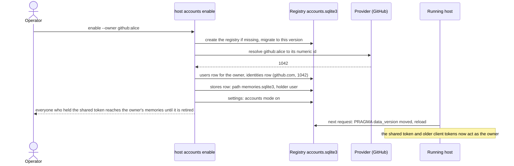
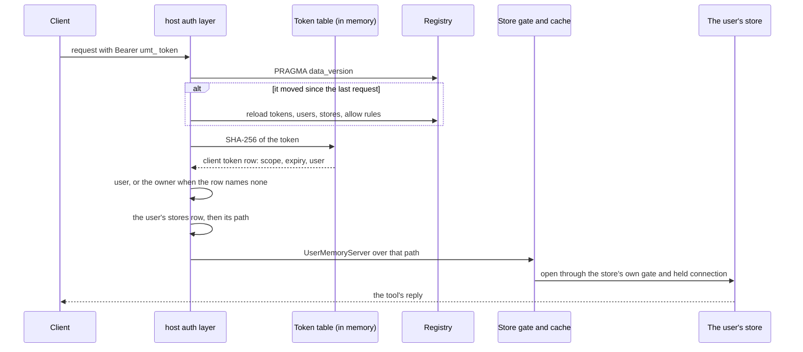
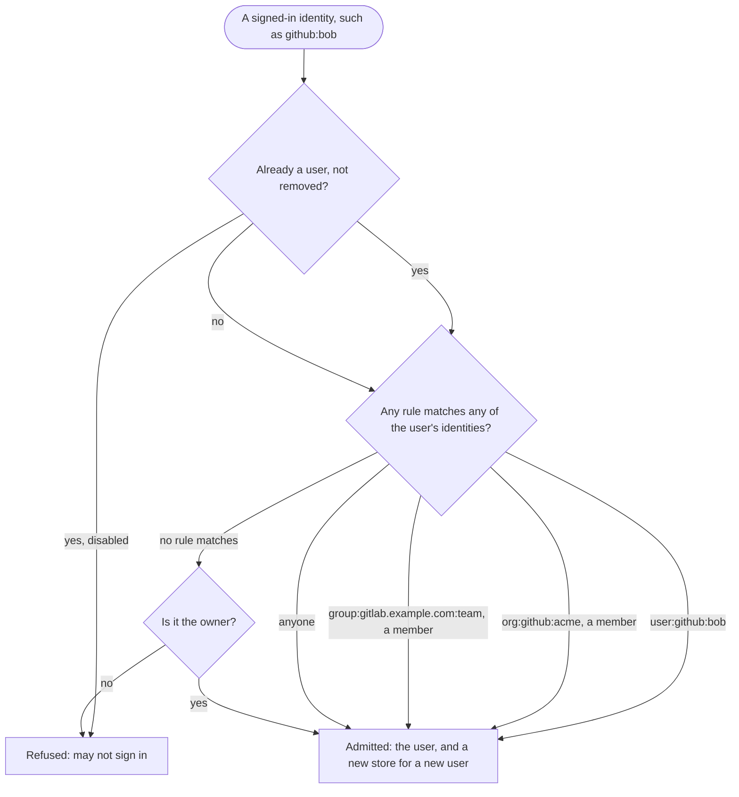
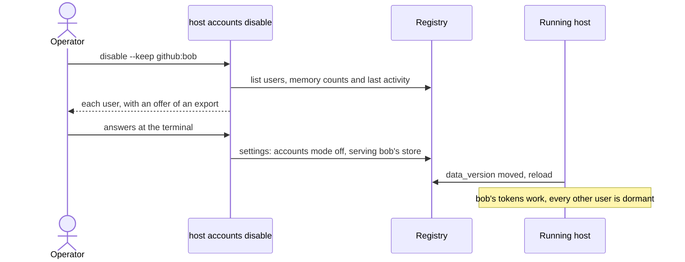
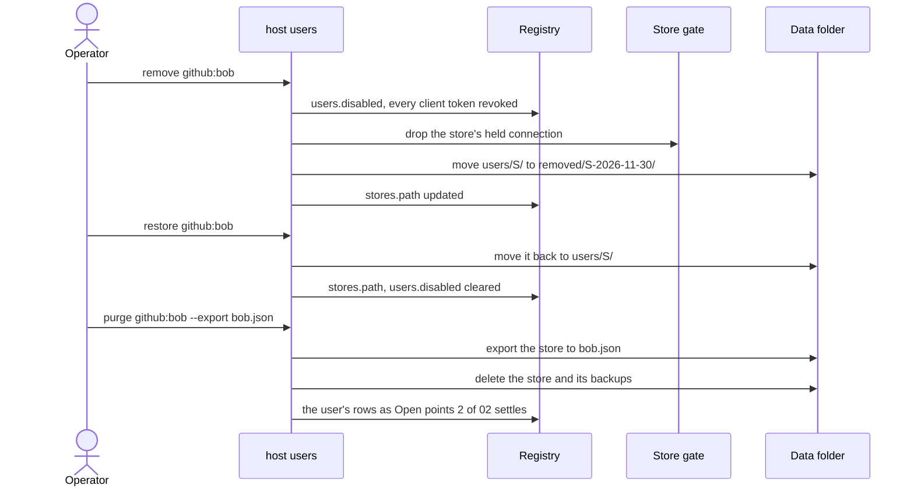
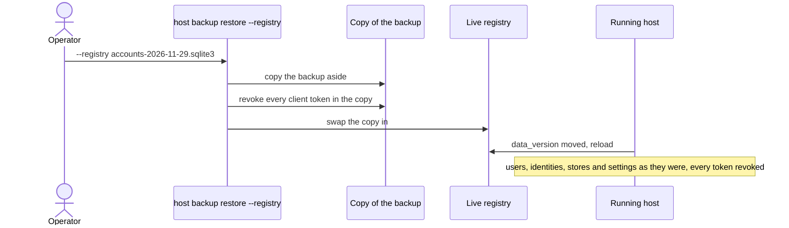
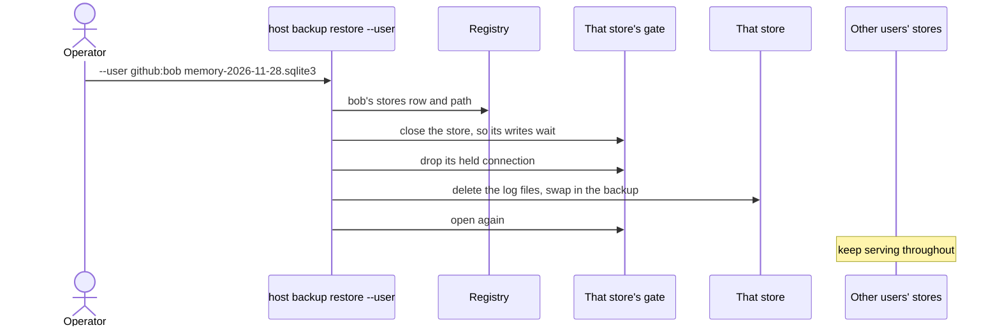
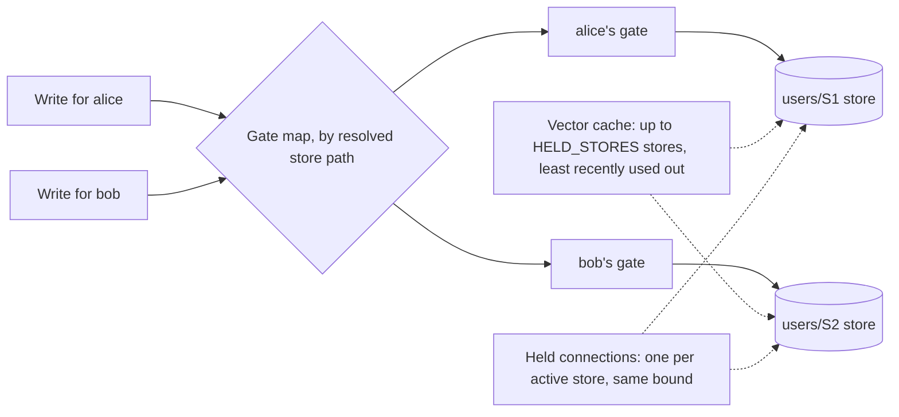
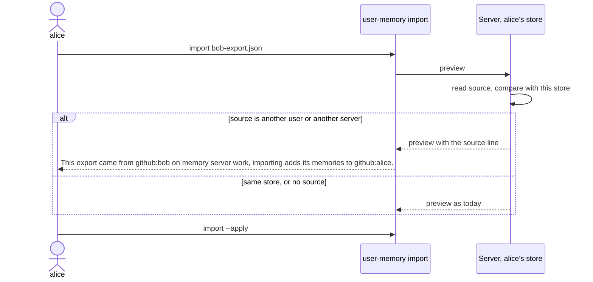

# 04. Accounts mode

How an operator turns accounts on and off, how a request finds its user's
store, who may sign in, and how per-user stores are run: restored,
repaired, upgraded and measured. It covers #63 (accounts on and off,
per-user stores, allow rules), #70 (operating per-user stores), #57
(per-store gates and caches) and #69 (an export's source).

Related: [02-data-model.md](02-data-model.md) for the registry and store
tables, [03-identity-and-auth.md](03-identity-and-auth.md) for sign-in and
tokens, [07-state-machines.md](07-state-machines.md) for the states of an
account and of a server's accounts mode, and
[08-edge-cases.md](08-edge-cases.md) for the full matrix.

## The two modes

| | Accounts off (today, and after `disable`) | Accounts on (after `enable`) |
|---|---|---|
| Stores served | one: the owner's `memories.sqlite3`, or a user's chosen with `disable --keep` | one per user, found through the registry's `stores` rows |
| Who may connect | anyone holding the shared file or a client token (#48) | users the allow rules admit, signed in (#64, #65), or holding a token that acts as a user |
| The shared token | the server's own | acts as the owner until `host token retire-shared` (#48) |
| Registry | only if `host token add` or `host invite` made one (#59, #68) | always; `enable` creates it if missing |
| A user who isn't served | none exist | dormant while accounts are off: refused, never merged or deleted |

A single-token server that never enables accounts is unchanged, with no
new file (#56, #63).

### Commands, on the server's machine (#63)

```
user-memory host --public-url URL                    (env USER_MEMORY_PUBLIC_URL)
user-memory host accounts enable --owner IDENTITY | disable [--keep USER] | status
user-memory host users list | remove USER | restore USER | purge USER [--export FILE] | link USER IDENTITY
user-memory host allow add RULE | remove RULE | list      (user:…, org:…, group:…, anyone)
```

Identities are written as `github:alice` and resolved to the provider's
numeric id at once (#63).

## Turning accounts on



The existing store becomes the owner's store row and keeps its path, so no
file moves. `enable` is live, with no restart (#63).

Error paths:
- **`--owner` missing while the store holds memories:** refused. On an
  empty server `--owner` is optional (#63).
- **The identity can't be resolved** (no such login, or the provider is
  unreachable): nothing is written; see [Open points](#open-points) for
  the message.
- **A wrong owner:** `host users link owner IDENTITY` fixes it (#63).
- **A registry with a newer schema version, or a damaged one:** refused as
  #59 says; accounts stay off.
- **Mid-session clients** keep working, as the owner (#63).

Clients still on the shared token see, once, at their next session start:

```output
Memory server work now has accounts; this machine still uses its token from before accounts, which acts as github:alice. To use your own account, run `user-memory login`.
```

## Routing a request



The tool code is unchanged: it gets one store, as today (#63). A store is
opened only for its own user's request (#56).

Error paths:
- **Unknown or revoked token:** 401 with `error_description="revoked"`;
  expired: `"expired"` (#48). The client's messages are in
  [03-identity-and-auth.md](03-identity-and-auth.md).
- **A read-only token on a write:** refused as a tool error with #48's
  message.
- **The user is disabled or removed:** 401; their tokens were revoked by
  `remove` (#63).
- **Accounts are off and the user isn't the one served:** 401 with
  `error_description="accounts are off on this server"`, which the client
  shows as:
  ```output
  Memory server work turned accounts off; its operator keeps your memories until accounts are on again. Ask them for an export.
  ```
- **The store fails its health check or is at an older version:** only
  this user is refused, with the repair or upgrade message for their store
  (#70).
- **The registry can't be read:** every authenticated request is refused
  with #59's message.

## Who may sign in: allow rules

Deny by default: with no rules, only the owner may sign in, and `anyone`
must be given explicitly (#63).



Rules match any identity of the user (#67). Org and group rules are checked
again later with the operator's credential (#66); without one, only at
sign-in, with #66's warning.

A refused identity sees:

```output
github:bob may not sign in to memory server work; ask its operator to allow you (on the server: user-memory host allow add user:github:bob)
```

Error paths:
- **The provider can't be reached to check an org or group:** at sign-in,
  refused until it answers. Later, the last good result holds for
  `MEMBERSHIP_GRACE` (#66).
- **A member who left the org:** refused at the next check, with a message
  naming the org (#66).
- **`host allow remove` of the rule that admitted a signed-in user:** the
  user keeps working until the next membership check or the next sign-in.
  See [Open points](#open-points).

## Turning accounts off



`disable` serves the owner's store again, or another user's with `--keep`.
It asks at a terminal (#63). Turning accounts on again restores the
dormant users; nothing is merged or deleted.

Error paths:
- **No terminal:** see [Open points](#open-points); #63 says it asks at a
  terminal but not what happens without one.
- **`--keep` names a removed user:** refused.
- **A dormant user's client:** the 401 above, at its next request.

## Removing, restoring and purging a user



`remove` disables at once: tokens revoked, sign-in refused. `purge` is the
only path that deletes memories, after offering an export (#63).

Error paths:
- **`remove` of the owner:** see [Open points](#open-points).
- **`purge` without a terminal and without `--export`:** see
  [Open points](#open-points).
- **The move fails** (disk full, permissions): the user stays disabled and
  the store stays in place; the command says so and `restore` undoes the
  disable.
- **`restore` while a restore of that user's backup runs:** refused, as
  #70 refuses a user removed while restoring.

## Registry backups and restore

Daily, in `<data>/accounts-backups/`, 7 kept, by the same online backup as
memory stores, and checked when the server starts and hourly (#52, #63).



Users sign in again. A memory-store restore never touches the registry, so
revoked tokens and removed users stay so (#63).

Error paths:
- **The backup is damaged or from a newer version:** refused before the
  swap; the live registry is unchanged.
- **The backup's `stores` rows name a folder that's gone** (a store
  purged after the backup): see [Open points](#open-points).

## Operating per-user stores (#70)

```
user-memory host backup restore --user USER BACKUP
user-memory repair --user USER | --all-users
user-memory migrate          (every store on the server)
```

### Restoring one user's store



Error paths:
- **The user is removed while restoring:** refused (#70).
- **Writes waiting on the gate past `BUSY`:** they fail with today's
  "database is locked" message and the client retries; the restore
  doesn't wait for them.
- **The backup is from a newer schema version:** refused; see
  [Open points](#open-points) for an older one.

### Upgrading every store

`migrate` upgrades every store the registry lists, each with its own
upgrade backup. A store that fails stays at its version and is refused
alone, with today's upgrade message naming it; the others are upgraded and
served (#70). The order of the steps, with the registry first, is in
[02-data-model.md](02-data-model.md#migrations).

Error paths:
- **One store damaged:** only its user gets "Database health check
  failed", with the repair command for their store (#70).
- **No registry:** one store, as today.

### Repairing

`repair --user USER` repairs one store; `--all-users` each in turn. Each
gets the backup repair makes today. The server keeps serving the others
(#70). A repair drops the store's held connection first, through #57's
explicit call.

### Sizes and backups in doctor

doctor, on the server, reports each store's size and stale or failed
automatic backups, by store id. It never shows memory text, and there's no
size limit (#70). When the disk fills, these lines find the cause.

## Per-store gates and caches (#57)

Three things are single per process today: the write gate
(`static WRITERS: Gate`, `src/memory/schema.rs:283`), the vector cache
(`static HELD`, `src/memory/index/vectors.rs:126`) and the held connection
(`memory::hold`, `src/memory/schema.rs:223`).



- Writers to one store queue as today; writers to different stores don't
  wait on each other.
- A cold store pays one load, as a server start does today.
- Dropping a store's held connection is an explicit call, which restore
  and repair use.

Error paths:
- **More active stores than the bound:** the least recently used is
  evicted and reloads on its next search; results are unchanged (#57).
- **A store's path changes** (`remove`, `restore`): its gate, cache slot
  and held connection go with the old path; see
  [Open points](#open-points).

## An export's source (#69)

An export file gains a top-level field:

```json
"source": {"server": "SHA256:…", "store": "<store id>", "kind": "user", "id": "<user id>", "login": "github:alice"}
```

- `server` is the server key's fingerprint (#58), or before keys exist,
  the store identity hash used for session snapshots.
- `kind` is `user` now; a group's export later uses `kind: "group"`. A
  local store's export has `kind: "local"` and no id.
- No format version bump: import reads only `format`, `format_version`,
  `memories` and `distinct_pairs` (`src/memory/transfer.rs:813`).



The line the issue fixes is:

```output
This export came from github:bob on memory server work; importing adds its memories to github:alice.
```

(The diagram writes it with a comma, because Mermaid ends a message at a
semicolon.)

Error paths:
- **An export without `source`,** from an older version, imports as today.
- **An older version importing a file with `source`** ignores the field.
- **A filtered export** keeps its `selection` and adds `source`.
- **The same user on another server:** shown, so the user knows it's a
  copy from elsewhere.

## Open points

Resolved by the user's decisions, and now in the issues:

1. Every store the registry lists gets the start, hourly, quiet-hour and
   last backup checks, in one sweep (#70).
2. The registry gets the quiet-hour and shutdown checks too (#63).
3. `enable` with an owner it can't resolve:
   `github:alice could not be found at github.com; accounts stay off.` (#63)
4. `disable` and `purge` refuse without a terminal (#63).
5. `host users remove` refuses the owner; link another owner first (#63).
6. A removed allow rule takes effect at the next membership check, or at
   once for a `user:` rule (#63).
7. Restoring a registry backup that names a purged store marks that user
   removed and lists them (#63).
8. Restoring an older backup upgrades it after the swap, with its own
   `.bak` (#70).
9. Gates and caches are keyed by store id when there's a registry, by
   path without one (#57).
10. Before #58, `source.server` uses the URL hash #61 uses (#69).
