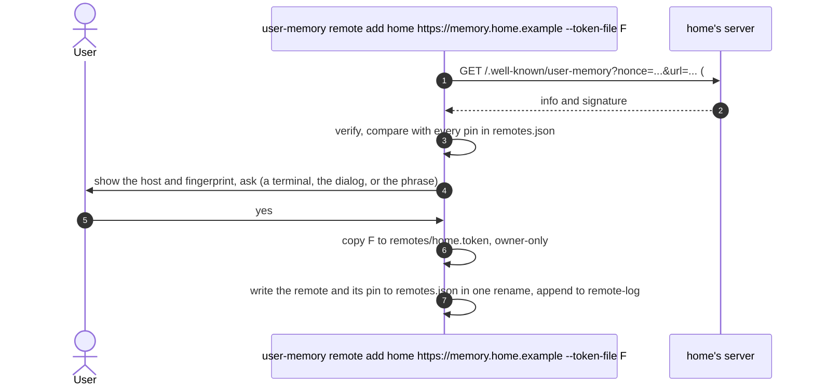
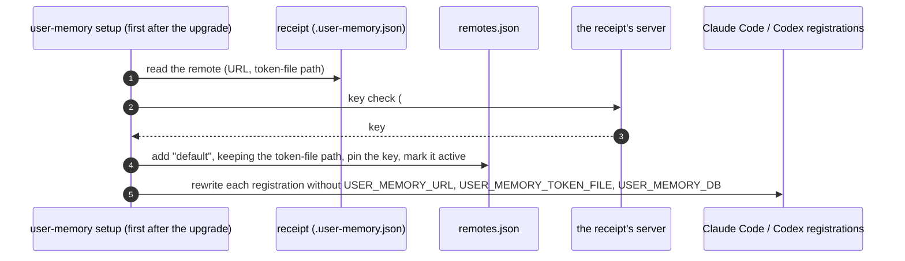
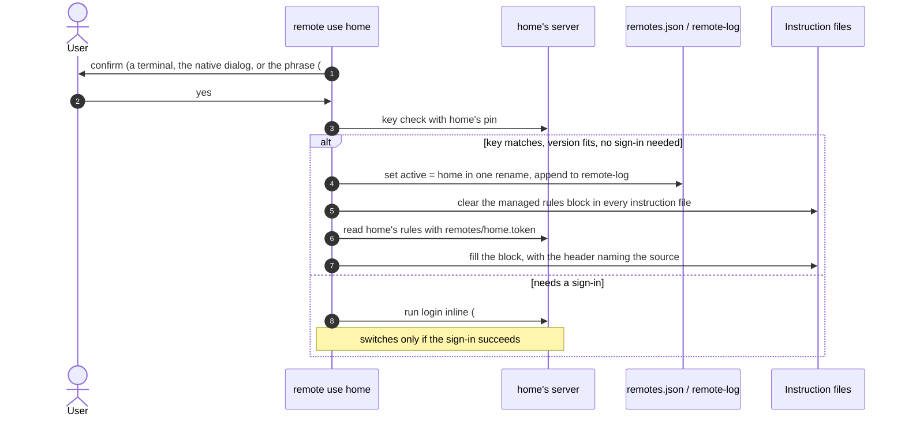
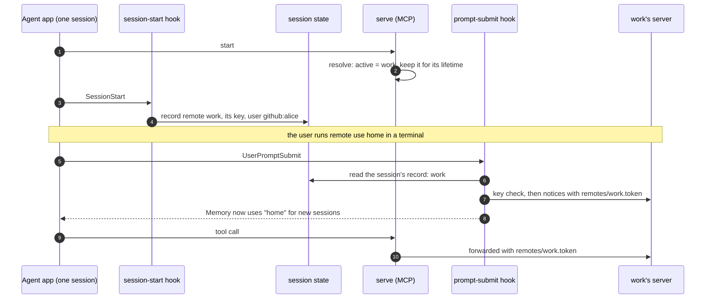
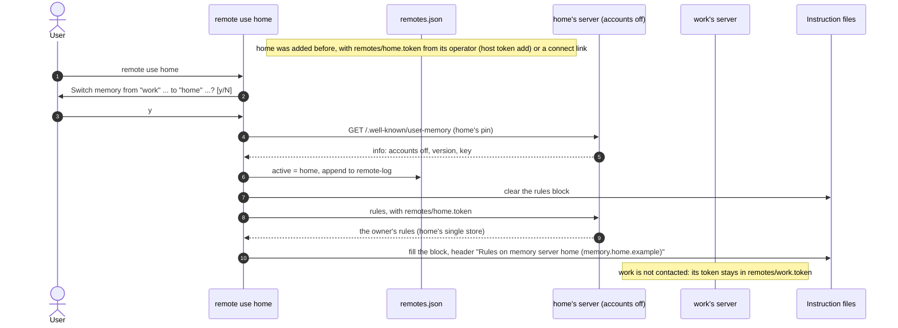
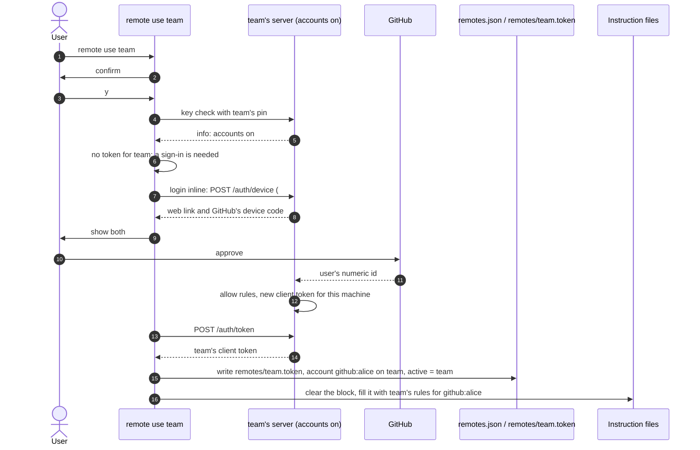
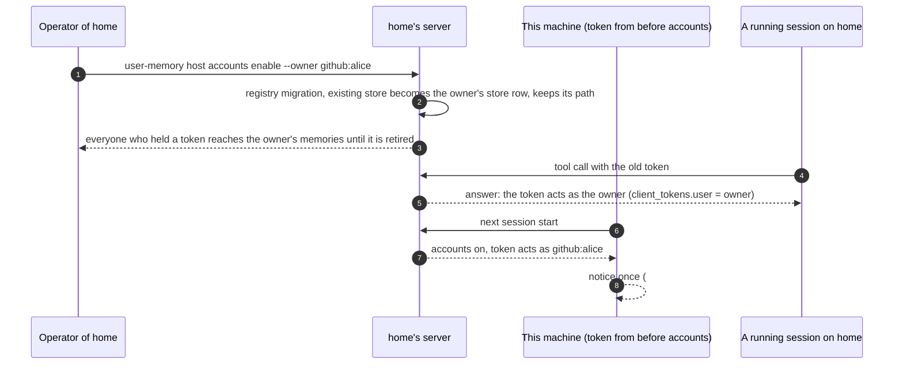
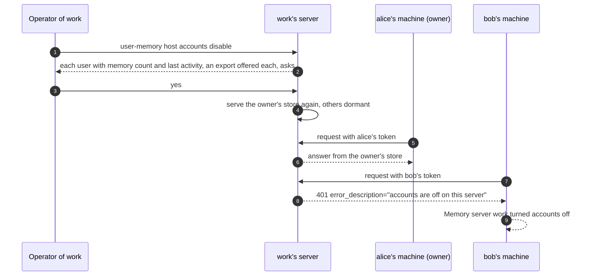
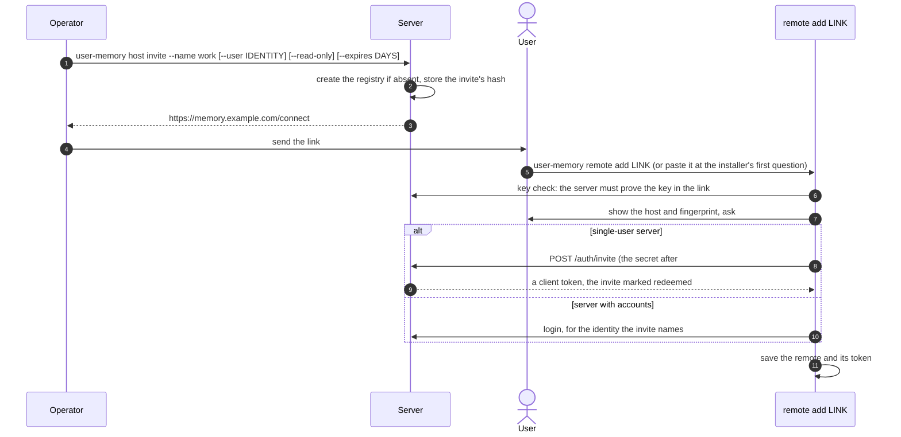
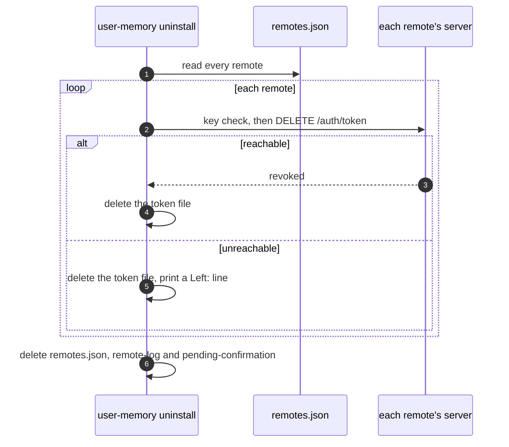

# 05 Remotes and switching

How a machine knows several memory servers, switches between them, joins
one with a link, and signs out of all of them on uninstall. Covers [#60](https://github.com/l7aromeo/user-memory/issues/60),
[#61](https://github.com/l7aromeo/user-memory/issues/61), [#68](https://github.com/l7aromeo/user-memory/issues/68) and [#71](https://github.com/l7aromeo/user-memory/issues/71).

Keys, tokens and sign-in are in [03-identity-and-auth.md](03-identity-and-auth.md).
How each command is confirmed (the terminal, the native dialog, or the
typed phrase without a display) is in
[06-confirmation-and-approval.md](06-confirmation-and-approval.md). The
states of a remote on a machine are in [07-state-machines.md](07-state-machines.md).
The client files are in [02-data-model.md](02-data-model.md).

## Names used in the examples

| Remote | Server | Accounts | This machine's credential |
|---|---|---|---|
| `work` | memory.example.com | on | signed in as `github:alice`, token in `remotes/work.token` |
| `home` | memory.home.example | off | a client token from its operator, in `remotes/home.token` |
| `team` | memory.team.example | on | not signed in yet |
| `local` | this machine's store | — | none (reserved name) |

## Remotes ([#60](https://github.com/l7aromeo/user-memory/issues/60))

### Files

- `~/.config/user-memory/remotes.json`, version 1: the active remote and,
  for each remote, its URL, key pin and key history, account (user id,
  login), client name and token path, and when it was added.
- `~/.config/user-memory/remotes/<name>.token`: one per remote, owner-only,
  never inside the JSON.
- `~/.local/state/user-memory/remote-log`: every add, use, trust,
  set-token, login and logout, with the time and how it was confirmed: at
  a terminal, in the native dialog, or by the typed phrase ([#62](https://github.com/l7aromeo/user-memory/issues/62)).

### Commands

```
user-memory remote list
user-memory remote add NAME URL|CONNECT-LINK [--token-file F]
user-memory remote show [NAME]
user-memory remote rename OLD NEW
user-memory remote set-url NAME URL
user-memory remote remove NAME
user-memory remote use NAME|local          (#61)
```

### Adding a remote



Error paths:
- **`local`:** reserved; refused as a name.
- **The same key as another remote:** a warning,
  `"home" is the same server as "work" (same key)`.
- **The signature doesn't verify:** refused, nothing saved.
- **Without a terminal:** the native dialog ([#62](https://github.com/l7aromeo/user-memory/issues/62)); without a display, a
  pending request with the phrase `trust memory server home 9a1b2c3d` (the
  last 8 characters of the fingerprint).
- **Unreachable:** nothing to pin, so the remote isn't added (see open
  point 3 for adding before the server is up).

### Changing a remote

- `set-url` is accepted only when the server at the new URL proves the
  pinned key, as for a domain move. It confirms like the others; its
  phrase, without a display, is
  `move memory server work to memory2.example.com`.
- `rename` changes the name in `remotes.json`, the token file's name and
  the active pointer, in one rename of the JSON.
- `remove` revokes this machine's token on the server when it can be
  reached (`DELETE /auth/token`), then deletes the token file and the
  pin. It refuses the active remote.

### Which server a process uses

`serve` and the hooks take the first of:
1. `USER_MEMORY_URL` with `USER_MEMORY_TOKEN_FILE`, plus an optional
   `USER_MEMORY_SERVER_KEY`;
2. `USER_MEMORY_DB`;
3. the active remote;
4. the receipt's remote, before migration;
5. the local store.

Environment setups and CI keep their meaning and priority.

### The one-time migration



Error paths:
- **A local-only install:** nothing changes; no `remotes*` file is created
  until a `remote` command runs.
- **The server is unreachable during setup:** see open point 3.
- **A server without a key** (older than [#58](https://github.com/l7aromeo/user-memory/issues/58)): recorded as having no
  key, as [#58](https://github.com/l7aromeo/user-memory/issues/58) says.

doctor's server line becomes
`Memory server: work (memory.example.com), signed in as github:alice: OK`,
and without accounts `Memory server: home (memory.home.example): OK`.

## Switching ([#61](https://github.com/l7aromeo/user-memory/issues/61))

### `user-memory remote use NAME|local`



The confirmation:

```output
Switch memory from "work" (memory.example.com, signed in as github:alice)
to "home" (memory.home.example)?
Running sessions keep using "work" until they restart. [y/N]
```

The header the block gets:

```output
<!-- Rules of github:alice on memory server work (memory.example.com); rewritten by user-memory. -->
```

Error paths:
- **Unreachable:** switches anyway, since the key is pinned, and says
  ``home is unreachable now; new sessions will say so until it answers``.
  The rules block is cleared and stays empty until home answers.
- **Key mismatch:** refuses with [#58](https://github.com/l7aromeo/user-memory/issues/58)'s message; nothing is changed or sent.
- **Version gap:**
  ``home runs user-memory 0.9.1; this client needs 0.11 or newer. Update the server, or keep using work.``
- **Without a terminal, before [#62](https://github.com/l7aromeo/user-memory/issues/62):**
  `Switching memory servers needs you at a terminal; run "user-memory remote use home" yourself.`
- **Without a terminal, after [#62](https://github.com/l7aromeo/user-memory/issues/62):** the native dialog; without a display,
  a pending request and its phrase `switch memory to home`, which the hook
  applies (see below).
- **The active remote is set by the environment** (`USER_MEMORY_URL`):
  see open point 5.

### Running sessions keep their server



The prompt hook prints that notice once. The next session start says
what changed:

```output
This machine switched memory servers at 14:03 today: from work (memory.example.com) to home (memory.home.example). If you did not ask for this, switch back with `user-memory remote use work`.
```

Error paths:
- **The new server is unreachable at the next session start:** today's
  `User memory unavailable: …`, with the reason.
- **A switch between `serve` starting and SessionStart:** see open
  point 4.

### What moves and what stays

| Thing | On a switch |
|---|---|
| Rules block in the instruction files | cleared, then filled from the target; never left with another server's or account's rules |
| `.user-memory` and `.user-memory-key` | unchanged |
| The embedding setting | unchanged: each server's own |
| Conversation links | stay on their server |
| Session snapshots | kept, keyed by the server key's fingerprint and the user id, or by the URL hash for a server without a key; found again on switching back |
| Tokens | each remote keeps its own; switching away never signs out |
| Claude Code and Codex | one switch covers both |

## Switching between servers with accounts on and off

The machine starts on `work` (accounts on, signed in as `github:alice`),
switches to `home` (accounts off), then to `team` (accounts on, not
signed in yet). Each server only ever sees its own token.

### Why credentials can't clash

- **One token per remote, in its own file:** `remotes/work.token`,
  `remotes/home.token`, `remotes/team.token`. A request reads the token of
  the remote it goes to, chosen by name from the session's record or the
  active remote, never "the current token".
- **The key check comes first, bound to the URL:** the client sends a
  token only after the server at that URL proves the key pinned for that
  remote ([#58](https://github.com/l7aromeo/user-memory/issues/58)). A token can't reach a server whose key isn't that remote's
  pin, even if two remotes are mistyped to the same URL.
- **Tokens are per server:** each server issued its own token and keeps
  only its hash; work's token is unknown to home and team.
- **The account is per remote:** `remotes.json` keeps each remote's
  account, so "signed in as github:alice" on work says nothing about team.

### work to home (accounts off)



Error paths:
- **home has no token on this machine:** see open point 3.
- **home's token was revoked:** the rules read gets a 401 with
  `error_description="revoked"`; the switch is done but the block stays
  empty, and [#48](https://github.com/l7aromeo/user-memory/issues/48)'s revoked message names the fix.
- **home is older than [#58](https://github.com/l7aromeo/user-memory/issues/58) and has no key:** recorded as having no key;
  once a key has been seen, its absence is a mismatch.

### home to team (accounts on, not signed in)



Error paths:
- **The sign-in is declined, expires or is refused by team's allow
  rules:** nothing is switched; the machine stays on home, and [#64](https://github.com/l7aromeo/user-memory/issues/64)'s
  message is shown.
- **Without a terminal ([#62](https://github.com/l7aromeo/user-memory/issues/62)):** the command runs the sign-in, then asks in
  the native dialog. Without a display, it holds the new token in
  `pending-confirmation` and prints `switch memory to team`; the hook
  writes the token and sets active on the exact phrase. Cancel, or an
  expired request, revokes the held token on team.
- **team has the same key as another remote:** the warning
  `"team" is the same server as "work" (same key)`; the user decides.

### Switching back to work

`user-memory remote use work`: the same checks. work's pin, token and
snapshots are reused; no new sign-in unless the token was revoked or
expired, in which case [#48](https://github.com/l7aromeo/user-memory/issues/48)'s message (with accounts, naming
`user-memory login`) follows.

## A server turns accounts on or off while machines use it

### home turns accounts on



The notice, as [#63](https://github.com/l7aromeo/user-memory/issues/63) words it:

```output
Memory server work now has accounts; this machine still uses its token from before accounts, which acts as github:alice. To use your own account, run `user-memory login`.
```

Error paths:
- **This machine's person isn't the owner** (a household member using
  the owner's server): their token still reaches the owner's memories
  until the operator revokes it or they sign in as themselves.
  `user-memory login home` gives them their own, empty store; the shared
  store goes whole to the owner ([#63](https://github.com/l7aromeo/user-memory/issues/63)), who can give them a filtered export.
- **`login home` when the old token works:** a sign-in as a named account
  replaces the token file; it's `login` as another account, so without a
  terminal it asks in the native dialog, or without a display needs
  `sign memory in as github:bob`.
- **The notice's wording for a client token:** see
  [03-identity-and-auth.md](03-identity-and-auth.md), open point 4.

### work turns accounts off



Error paths:
- **`disable --keep github:bob`:** bob's store is served, and alice's
  machine gets the dormant answer instead.
- **A session running on work when it turns off:** its next call gets the
  dormant answer; the session isn't moved to another server.
- **Turning accounts on again:** dormant users come back; nothing was
  merged or deleted.
- **The dormant user's rules block:** see open point 6.

## Joining with a connect link ([#68](https://github.com/l7aromeo/user-memory/issues/68))



- The secret part sits after `#`, so proxies and server logs never see it.
- Opened in a browser, `/connect` shows the one command to run, with the
  link filled in.
- The installer's first question becomes
  ``Memory server address or connect link (Enter to set one up on this machine):``,
  replacing ``Do you already have a user-memory server?``.
- The installer's own Docker server pins its key straight from the volume.

Error paths:
- **An expired or used invite:** refused, naming the operator's
  `host invite`.
- **A link for another server** (one planted in a README): the key check
  fails, and nothing is sent.
- **The user declines at the fingerprint:** nothing is saved, and the
  invite stays unredeemed.

## Signing out of every remote on uninstall ([#71](https://github.com/l7aromeo/user-memory/issues/71))



An unreachable remote leaves:

```output
Left: this machine's token for remote work (memory.example.com could not be reached); revoke it from another machine with `user-memory account clients revoke laptop`
```

Error paths:
- **Something left:** exit code 1, as today.
- **`--dry-run`:** lists what it would do and changes nothing.
- **A server without accounts:** a client token is revoked the same way;
  the shared token file is left, as today.
- **A key mismatch:** the token isn't sent; it counts as unreachable for
  this purpose (see open point 7).
- **`--purge`:** unchanged for the local store.

## Open points

Resolved by the user's decisions, and now in the issues:

1. `remote trust` belongs to [#60](https://github.com/l7aromeo/user-memory/issues/60).
2. `remote set-token NAME FILE` replaces a remote's token ([#60](https://github.com/l7aromeo/user-memory/issues/60)).
3. `remote use` to a server without accounts and without a token refuses
   with
   ``home has no token on this machine; ask its operator for a token file or a connect link, then run `user-memory remote set-token home FILE` ``
   ([#61](https://github.com/l7aromeo/user-memory/issues/61)); `add` needs the server reachable, and the migration pins at
   first contact ([#60](https://github.com/l7aromeo/user-memory/issues/60)).
4. The window between `serve` and SessionStart is closed ([#61](https://github.com/l7aromeo/user-memory/issues/61)).
5. `remote use` says when `USER_MEMORY_URL` or `USER_MEMORY_DB` overrides
   the switch, and doctor names the override ([#61](https://github.com/l7aromeo/user-memory/issues/61)).
6. Session start clears the rules block on a 401 from the active remote,
   as `logout` does ([#61](https://github.com/l7aromeo/user-memory/issues/61)).
7. Uninstall leaves a remote whose key doesn't match like an unreachable
   one, with a `Left:` line naming the mismatch ([#71](https://github.com/l7aromeo/user-memory/issues/71)).
8. The rules header without accounts is
   `<!-- Rules on memory server home (memory.home.example); rewritten by user-memory. -->`
   ([#61](https://github.com/l7aromeo/user-memory/issues/61)).
