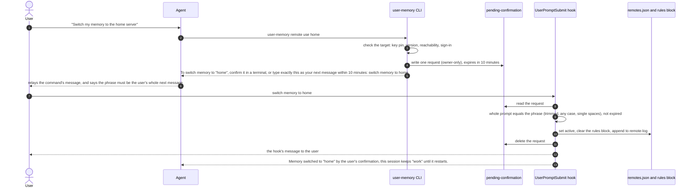
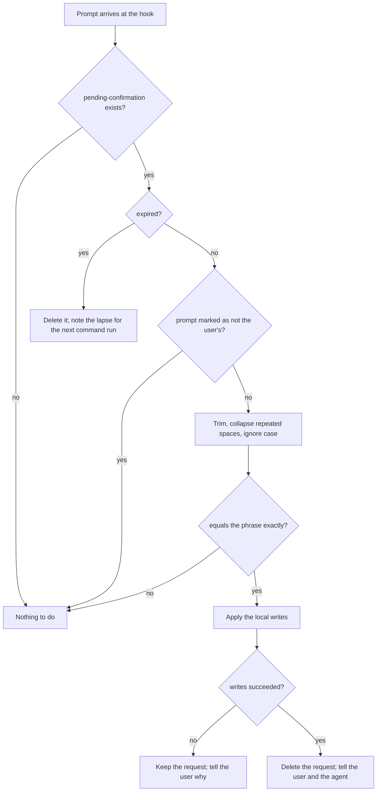
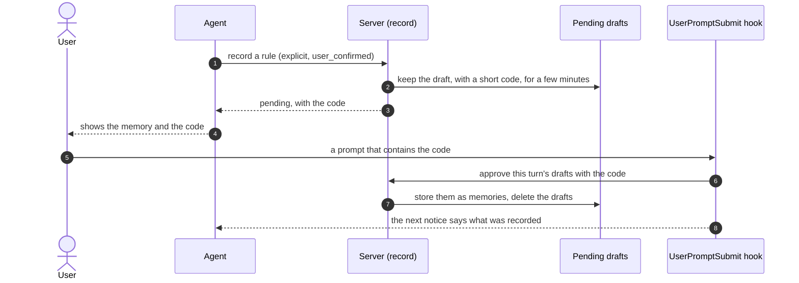

# 06. Confirmation and approval

Two questions, one mechanism:

- **#62:** how does the user confirm a command that changes where memory
  goes, or whose it is, when the agent ran it in a shell with no terminal?
- **#53:** can the server rely on `user_confirmed` for rules, and if not,
  what would make approval verifiable?

Both rest on the same fact: the user's own prompt reaches the
UserPromptSubmit hook, and an agent never writes that prompt.

## 1. Confirming sensitive commands by the next prompt (#62)

### 1.1 Why a phrase, and not a terminal or `--yes`

- Agent shells have no controlling terminal, and neither do `!` commands in
  Claude Code and Codex. A terminal-only rule would send the user to a
  separate terminal for every switch.
- A `--yes` flag would let an agent switch on its own. None of the covered
  commands has one.

### 1.2 Commands covered and their phrases

The phrases are user-facing text and fixed once (#62).

| Command | Phrase |
|---|---|
| `remote use home` | `switch memory to home` |
| `remote add work …`, `remote trust work …` | `trust memory server work 9a1b2c3d` (the last 8 characters of the fingerprint) |
| `remote set-url work …` | `move memory server work to memory2.example.com` |
| `login` as `github:bob` | `sign memory in as github:bob` |
| `account link gitlab` | `link gitlab:alice to my memory` |
| `account unlink github:alice` | `unlink github:alice from my memory` |
| `account delete` | `delete my memory account` |

At a terminal, each command asks there instead, as #61 shows for
`remote use`:

```output
Switch memory from "work" (memory.example.com, signed in as github:alice)
to "home" (memory.home.example)?
Running sessions keep using "work" until they restart. [y/N]
```

Until #62 lands, `remote use` without a terminal refuses with
`Switching memory servers needs you at a terminal; run "user-memory remote use home" yourself.`
(#61).

### 1.3 The flow without a terminal



Mermaid ends a message at a semicolon, so step 13 shows a comma. The text
the agent gets is #62's:

```output
Memory switched to "home" by the user's confirmation; this session keeps "work" until it restarts.
```

Error paths:

- **Step 3 fails** (key mismatch, version gap, unreachable target): the
  command reports it as #58 and #61 define, and writes no request. An
  unreachable target still switches, since the key is pinned, and says
  ``home is unreachable now; new sessions will say so until it answers``.
- **A newer request replaces an older one** (step 4): the file holds one
  request. Typing the older phrase then matches nothing.
- **The prompt isn't exactly the phrase** (step 9): the phrase inside a
  longer message, a wrong phrase or a misspelt name. The hook leaves the
  request in place and does nothing; the prompt reaches the agent as an
  ordinary message.
- **The request expired** (step 9): the hook deletes it at its next run. A
  token held for `login` is revoked on the server, and the command's next
  run says the request lapsed (see open point 1).
- **The local write fails** (step 10), for example a full disk: the hook
  keeps the request, prints the reason to the user, and the phrase can be
  typed again until the request expires.
- **The phrase is reused** after it applied: the request is gone, so it
  matches nothing.

### 1.4 The pending request

`~/.local/state/user-memory/pending-confirmation`, owner-only through
`src/private.rs`, one JSON object. Proposed fields (#62 names the content,
not the layout):

| Field | Holds |
|---|---|
| `command` | The covered command, such as `remote use`. |
| `phrase` | The exact phrase, already normalised. |
| `created`, `expires` | UTC times; `expires` is `created` plus `CONFIRMATION_EXPIRY` (10 minutes). |
| `target` | What the command checked: the remote name, URL, the fingerprint seen, the account. |
| `held_token` | For `login` only: the new client token, until the phrase applies it. The file is written through `src/private.rs` and deleted once used, as [09](09-security.md) open point 1 asks. |
| `origin` | The session that ran the command, when known, for `remote-log`. |

The hook acts only on what the request already holds. Everything that
needs the network ran in the command (step 3). The hook's work is local
and fits its time limit:

- set `active`, write the held token to the remote's token file, or write
  the pin;
- clear the rules block, which the next session start refills;
- append to `remote-log`, with how it was confirmed.

### 1.5 Matching the phrase



Error paths are the "no" branches above: each leaves the prompt to reach
the agent unchanged.

### 1.6 Where the prompt comes from, per client

| Client | Prompt in the hook payload | Prompts that aren't the user's |
|---|---|---|
| Claude Code | `prompt` | To check when building: queued automation and scheduled prompts. |
| Codex | `UserPromptSubmitRequest.prompt` | `codex exec` and messages from other sessions: to check when building. |
| Hermes Agent | `extra.user_message` of `pre_llm_call` ([10](10-agent-integrations.md)) | Gateway messages from chat platforms are user messages; scheduled jobs need checking. |
| Pi | `before_agent_start` with `messageType` `"user"` and `prompt` ([10](10-agent-integrations.md)) | `pi.sendUserMessage()` from an extension also has `messageType` `"user"`, so an extension could confirm. |
| A client without a prompt hook | none | Confirmation at a terminal only. |

The docs say, per client, where it can't tell a user's prompt from an
automated one (#62).

### 1.7 Visible afterwards

- `remote-log` records each add, use, trust, login and logout, with the
  time and whether it was confirmed at a terminal or by a prompt (#60).
- The next session start says "confirmed in a terminal" or "confirmed by
  your message" (#62), beside #61's notice:

  ```output
  This machine switched memory servers at 14:03 today: from work (memory.example.com) to home (memory.home.example). If you did not ask for this, switch back with `user-memory remote use work`.
  ```

### 1.8 The limit

A confirmation stops an agent from switching by accident, or because text
it read told it to. A program running as the user that sets out to edit
`remotes.json` directly can still do it (#62, #73). The session-start
notice makes such a change visible after the fact.

## 2. Approval the server can rely on for rules (#53)

### 2.1 The problem

`user_confirmed` is a field of the call. The server checks it for explicit
and global records, updates, forgets, imports and `review --keep`, but it
can't tell a client that asked the user from one that didn't, or from one
steered by text it read. A rule recorded with it applies in every session
and in the instruction files. The command line counts as the user's yes,
and most clients can run shell commands.

No scheme stops a program running as the user from forging a yes on
purpose: it can reach the store, the token, the command line and any state
a hook keeps. A design can stop a yes being claimed without asking, stop
read text from becoming a rule, and make every rule visible and
reversible.

### 2.2 Where the options stand

| Option | What | State |
|---|---|---|
| O1 | Document what `user_confirmed` proves | Done in v0.9.2 (#40): docs/memory-model.md, "What the server can and cannot check". |
| O2 | Show new rules at session start | In v0.10.0 (#42), with the origin and, after #39, the client. |
| O3 | Approval codes typed by the user | Not built. Reuses #62's hook mechanism. |
| O4 | Propose-only tokens | Not built. #48's scopes (`write`, `read`) leave room for a third. |
| O5 | Operating-system approval | Not built. |

### 2.3 A design for O3, on #62's mechanism

If the user picks O3, it can share #62's matching and expiry rather than
build a second mechanism:



Error paths:

- **The code never comes:** the drafts expire and nothing is stored. The
  agent sees the next notice say so.
- **The code is wrong:** nothing is approved.
- **A client without a prompt hook:** the fallback `user-memory approve CODE`,
  which a program with a shell can also run (#53).
- **The command line:** must stop confirming rules on its own, or the path
  stays open (#53). That is a contract change for `record`.

Differences from #62, which the decision must weigh:

- #62's phrase must be the whole prompt; #53's code is found inside a
  prompt, so the user can approve while saying something else.
- #62 writes locally only; O3's hook calls the server, inside
  `PROMPT_LIMIT`.
- O3 changes `record`'s result and adds a pending-drafts table to the store
  (#53). #62 changes no store.

### 2.4 What each option buys

| Option | Stops a yes claimed without asking | Stops rules from read text | Stops deliberate forgery | Usability cost | Contract or store change |
|---|---|---|---|---|---|
| O1 | no | no | no | none | none |
| O2 | after the fact | after the fact | after the fact | none | none |
| O3 | yes (hook clients) | yes (hook clients) | no | a code per batch | yes, both |
| O4 | remote only | remote only | no | none | token format |
| O5 | yes | yes | yes | a prompt per rule | per platform |

### 2.5 Proposal

For the user to decide (#53 commits to nothing):

1. Ship O1 and O2 as they are (done, and in v0.10.0).
2. Build O3 after #62 lands, as one issue, sharing #62's prompt matching,
   expiry and per-client notes. It is the only option that stops read text
   from becoming a rule without a prompt per rule.
3. Leave O4 until per-agent tokens are common. #48's scope column can take
   a `propose` value later without a format change.
4. Leave O5 out: it covers nothing on a Linux server or in Docker.

## Open points

1. **Who revokes a lapsed `login` token.** #62 says an expired request is
   deleted at the next hook run, and its held token is revoked on the
   server. The hook does only local writes. Proposal: the hook deletes the
   request and leaves the held token file with a lapse mark; the next
   `user-memory` command that reaches that server, or the next session
   start, revokes it with `DELETE /auth/token`, and the token's 90-day
   expiry bounds it anyway. #62 needs a sentence saying which process
   revokes.
2. **Remote names in phrases.** A phrase holds the remote's name, which the
   user types. #60 doesn't restrict the characters of a name. Proposal: a
   name is lowercase letters, digits and `-`, and `local` stays reserved.
   #60 needs that rule.
3. **Fingerprint characters ignore case.** Phrases compare ignoring case,
   and the last 8 characters of a base64 fingerprint are case-sensitive.
   That leaves fewer distinct phrases, but the phrase only confirms a key
   the command already checked, so it isn't a security loss. #62 could say
   so.
4. **#53 needs a decision** on O3, O4 and O5; the proposal is above.
