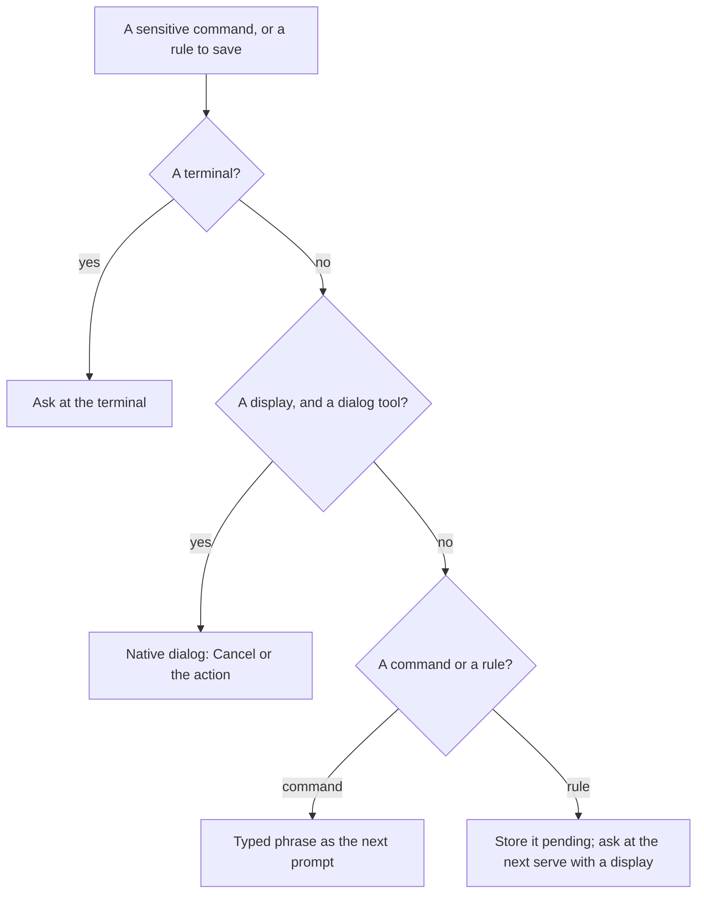
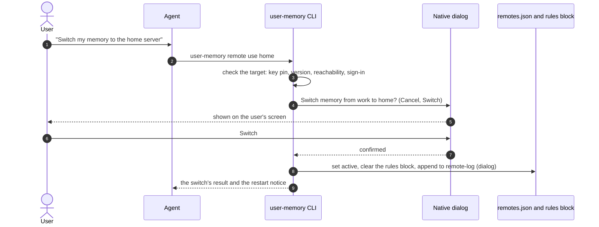
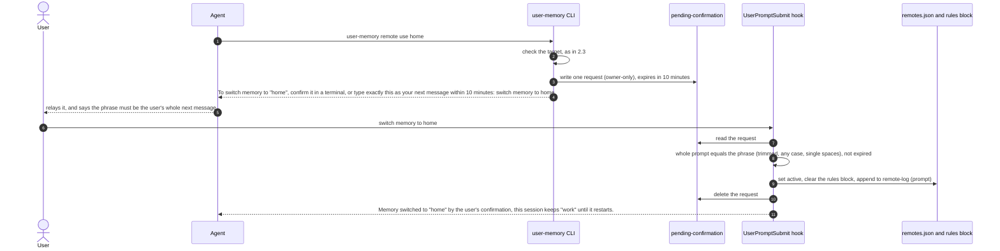
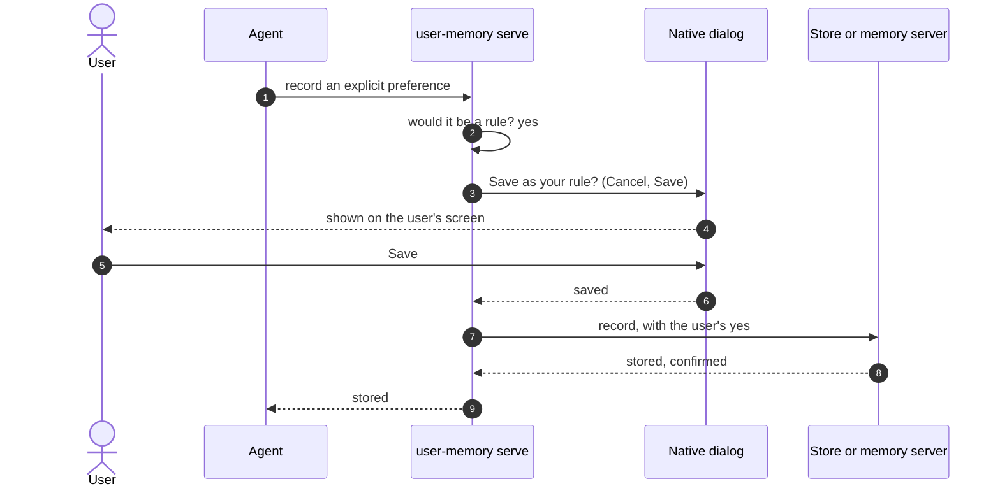
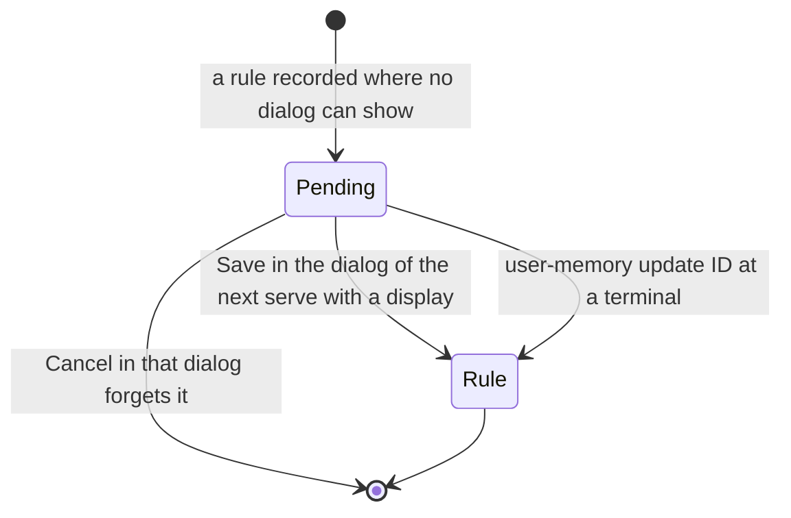

# 06. Confirmation and approval

Two questions, one answer:

- **#62:** how does the user confirm a command that changes where memory
  goes, or whose it is, when an agent ran it in a shell with no terminal?
- **#53:** how does the server know the user wanted a rule an agent
  records?

The answer is one native confirmation (the user's decision 5, under the
project rule to solve hard cases in the architecture, never by adding
steps, codes or choices for the user): the terminal when there is one,
otherwise a native dialog on the user's own machine. Only a machine that
can't show a dialog falls back, and the fallbacks need no new command.

## 1. One confirmation, three ways



| Where | How it asks |
|---|---|
| A terminal | The command's own `[y/N]` question. A rule typed at a terminal is the user's own yes, as today. |
| No terminal, a display | A native dialog titled `user-memory`, with Cancel (the default) and the action's button: macOS's system dialog, a Windows message box, zenity or kdialog on Linux desktops. |
| No terminal, no display | Commands: the typed phrase (section 2.4). Rules: kept pending (section 3.4). |

"No display" covers an SSH session, a headless Linux machine, a container,
a Windows service session, and a Linux desktop with neither zenity nor
kdialog. How each OS is detected is checked when building.

No answer within `CONFIRM_DIALOG_WAIT`, two minutes, counts as Cancel.

## 2. Sensitive commands (#62)

### 2.1 Commands, buttons and phrases

| Command | Dialog button | Phrase, without a display |
|---|---|---|
| `remote use home` | Switch | `switch memory to home` |
| `remote add work …`, `remote trust work …` | Trust | `trust memory server work 9a1b2c3d` (the last 8 characters of the fingerprint) |
| `remote set-url work …` | Move | `move memory server work to memory2.example.com` |
| `remote set-token work …` | Replace | `replace the token of memory server work` |
| `remote remove work` | Remove | `remove memory server work` |
| `login` as `github:bob` | Sign in | `sign memory in as github:bob` |
| `logout` | Sign out | `sign memory out of work` |
| `account link gitlab` | Link | `link gitlab:alice to my memory` |
| `account unlink github:alice` | Unlink | `unlink github:alice from my memory` |
| `account delete` | Delete | `delete my memory account` |

None has a `--yes`. The phrases are user-facing text and fixed once.

### 2.2 At a terminal

As #61 shows for `remote use`:

```output
Switch memory from "work" (memory.example.com, signed in as github:alice)
to "home" (memory.home.example)?
Running sessions keep using "work" until they restart. [y/N]
```

### 2.3 Without a terminal: the dialog



Error paths:

- **The checks fail** (step 3): a key mismatch, a version gap or a refused
  sign-in, with #58's and #61's messages. No dialog appears.
- **Cancel, or no answer** (step 6): nothing changes, and the command
  prints
  ```output
  Not changed: the confirmation was cancelled.
  ```
  A token held for `login` is revoked at once, since the command is still
  running.
- **The dialog tool can't start** (step 4): the command falls back to the
  typed phrase.
- **The local write fails** (step 8): the command reports it; nothing is
  half-switched, since `active` is set in one rename (#61).

### 2.4 Without a display: the typed phrase



Mermaid ends a message at a semicolon, so step 11 shows a comma. The text
the agent gets is #62's:

```output
Memory switched to "home" by the user's confirmation; this session keeps "work" until it restarts.
```

Error paths:

- **A newer request replaces an older one:** the file holds one request.
- **The prompt isn't exactly the phrase:** the phrase inside a longer
  message, a wrong phrase or a misspelt name. Nothing happens; the prompt
  reaches the agent as an ordinary message.
- **The request expired:** the hook deletes it at its next run and marks
  the held token lapsed. The next `user-memory` command that reaches that
  server, or the next session start, revokes it, and the command's next run
  says the request lapsed. The token's 90-day expiry (#48) bounds it
  anyway.
- **The local write fails:** the hook keeps the request and tells the
  user; the phrase can be typed again until it expires.
- **A reused phrase:** the request is gone, so it matches nothing.

**The request** (`~/.local/state/user-memory/pending-confirmation`) is
written owner-only through `src/private.rs`, holds one request, and is
deleted, not emptied, once used. It holds what the command checked: the
target's identity, the fingerprint for `trust`, and for `login` the new
token. A held token is an ordinary client token whose file the client
doesn't use until the request applies, so the server needs no new state.

**Matching ignores case.** That leaves fewer distinct fingerprint phrases,
which costs nothing: the phrase confirms a key the command already checked.

### 2.5 The prompt, per client

| Client | Prompt in the hook payload | Prompts that aren't the user's |
|---|---|---|
| Claude Code | `prompt` | To check when building: queued automation and scheduled prompts. |
| Codex | `UserPromptSubmitRequest.prompt` | `codex exec` and messages from other sessions: to check when building. |
| Hermes Agent | `extra.user_message` of `pre_llm_call` ([10](10-agent-integrations.md)) | Gateway messages from chat platforms are user messages; scheduled jobs need checking. |
| Pi | `before_agent_start` with `messageType` `"user"` and `prompt` ([10](10-agent-integrations.md)) | `pi.sendUserMessage()` from an extension also has `messageType` `"user"`. |
| A client without a prompt hook | none | No display: a terminal only. |

### 2.6 Visible afterwards

`remote-log` records how each change was confirmed: `terminal`, `dialog` or
`prompt`. The next session start says "confirmed in a terminal",
"confirmed in a dialog" or "confirmed by your message", beside #61's
notice:

```output
This machine switched memory servers at 14:03 today: from work (memory.example.com) to home (memory.home.example). If you did not ask for this, switch back with `user-memory remote use work`.
```

## 3. Rules (#53)

### 3.1 Where and when it asks

`user-memory serve`, the MCP process each app starts on the user's
machine, asks: for a local store, and as the client of a remote or Docker
server, which it forwards to. The command line asks the same way when it
has no terminal.

It asks before storing a memory that would become a rule:

- a `record` with source `explicit` and a rule type (`preference`,
  `constraint`, `value`);
- an `update` that would make a memory a rule, or change a rule's content,
  scope or project;
- an applied import whose preview lists rules (#43): once, naming how many.

Observations, inferences and project notes that aren't rules never ask.
The agent's `user_confirmed` doesn't replace the dialog for rules; for
everything else it keeps today's meaning.

### 3.2 The dialog

```output
Save as your rule: Prefer Rust over Python?
```

Cancel (the default) and Save. Only Save stores the rule. Cancel, or no
answer within `CONFIRM_DIALOG_WAIT`, returns a tool error the agent
relays:

```output
The user chose not to save this rule.
```



Error paths:

- **Cancel or no answer** (step 5): nothing is stored, and the agent gets
  `The user chose not to save this rule.`
- **The server refuses** (step 7), for example a duplicate the agent must
  resolve: the agent gets the server's answer, as today.
- **No dialog can show** (step 3): the memory is stored pending (3.4).

### 3.3 The command line

A rule typed at a terminal is the user's own yes, as today. Without a
terminal, which is how an agent's shell runs the command, the command line
shows the same dialog. That closes the path an agent's shell used to take
(`src/main.rs:434-436`).

### 3.4 Where no dialog can show



- The memory is stored `tentative`, so it isn't a rule yet. An explicit
  memory is otherwise always stored confirmed, so an explicit, tentative
  memory of a rule type is a pending rule, with no schema change. An import
  file can hold one too, and it is asked about the same way.
- The next `serve` that starts on a machine with a display asks, one dialog
  per pending rule. Save confirms it; Cancel forgets it.
- On a machine that never has a display, #42's block lists each pending
  rule at session start, with `user-memory update ID` to run at a terminal.
- A pending rule doesn't lapse: it waits until the user answers.

### 3.5 What was weighed

| Option | Outcome |
|---|---|
| Document what `user_confirmed` proves | Done in v0.9.2 (#40). |
| Show new rules at session start | In v0.10.0 (#42). |
| Approval codes typed by the user | Dropped: a code is a step the user must get right for every batch. |
| Propose-only tokens | Read-only tokens (#48) cover clients that don't write; a third scope can come later. |
| Biometric approval | The dialog is the same native approval, without per-platform biometric code, and works on Linux desktops. |

## 4. The limit

Stated plainly, as #53, #62 and #73 require:

- An agent with a shell and the machine's token can call the server
  directly, skipping `serve` and its dialog. Read-only tokens (#48) close
  that for clients that don't need to write.
- A program running as the user can edit `remotes.json`, or drive a dialog
  through the desktop's accessibility tools.

What the confirmation does stop: a change or a rule claimed without
asking, and one taken from text an agent read. The next session start
shows every switch, and #42's block every new rule, so the rest is visible
after the fact.

## Open points

Checks for building, not decisions:

1. How each OS tells a display is there (a macOS GUI session, `DISPLAY` or
   `WAYLAND_DISPLAY` with zenity or kdialog, an interactive Windows
   desktop).
2. A fake dialog program a debug build takes from the environment, so the
   tests drive Save and Cancel (#53, #62).
3. Which prompts each client marks as not the user's (2.5).
