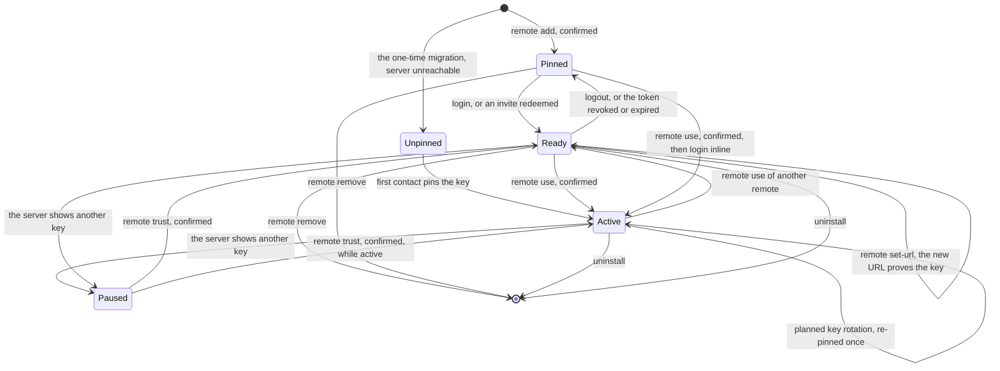
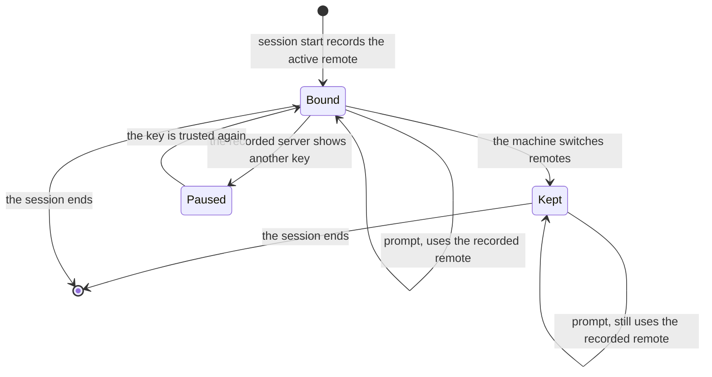
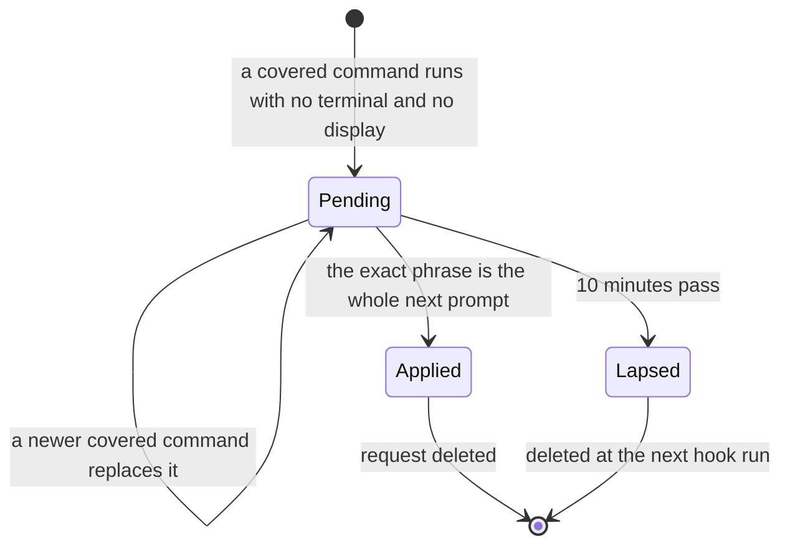
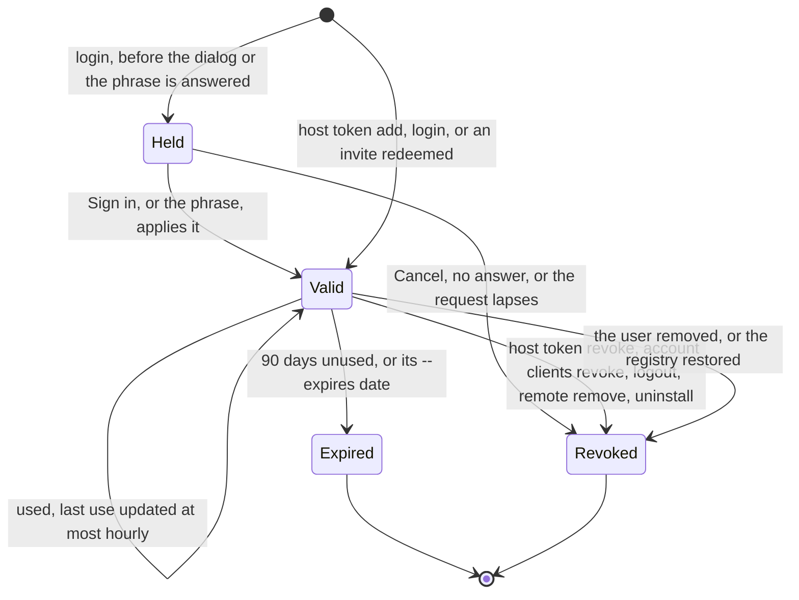
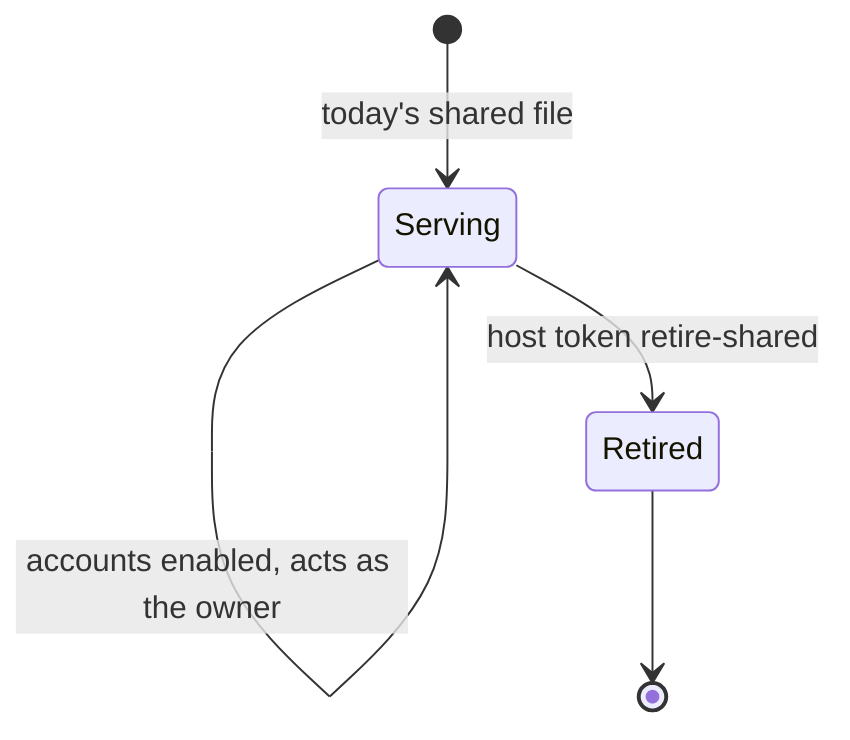
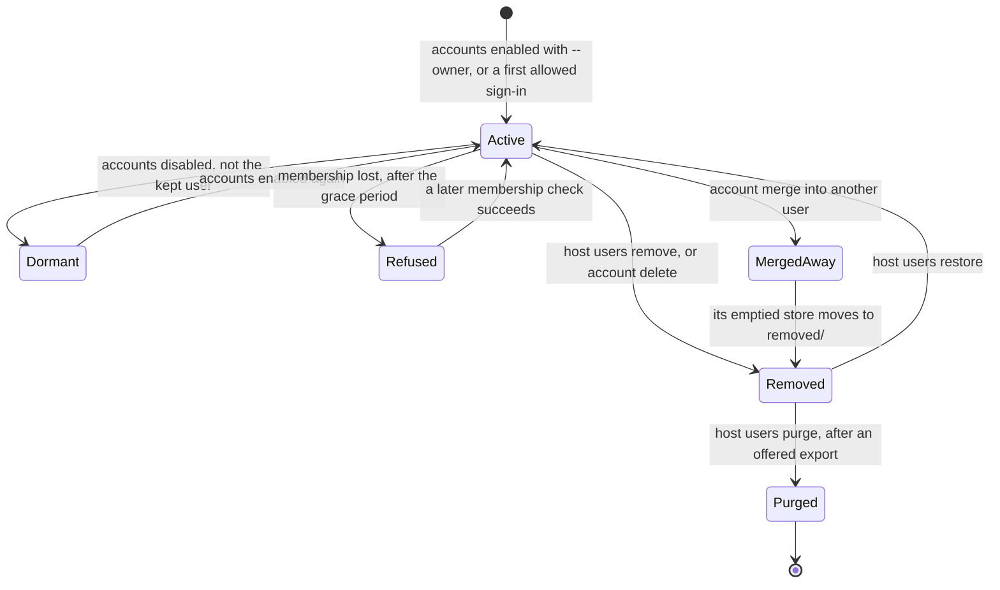
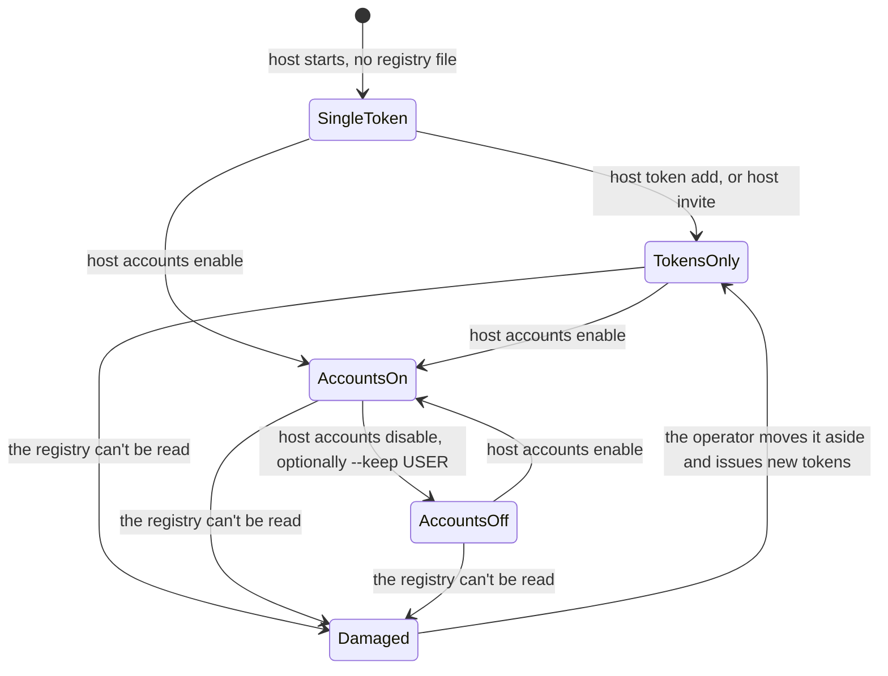

# 07. State machines

Six lifecycles carry the design. Each diagram is followed by the error
paths and the messages the user sees. The commands and messages are the
issues' own.

1. [A remote on a machine](#1-a-remote-on-a-machine) (#58, #60, #61, #64, #71)
2. [A session's server](#2-a-sessions-server) (#61)
3. [A pending confirmation](#3-a-pending-confirmation) (#62); a pending rule is in [06](06-confirmation-and-approval.md) section 3.4 (#53)
4. [A client token](#4-a-client-token) (#48, #63, #64, #67, #68, #71)
5. [An account](#5-an-account) (#63, #66, #67)
6. [A server's accounts mode](#6-a-servers-accounts-mode) (#59, #63, #68)

## 1. A remote on a machine

A remote is an entry in `~/.config/user-memory/remotes.json`, with its
token in `~/.config/user-memory/remotes/<name>.token` (#60).



- **Pinned:** the key is trusted, and there is no token yet.
- **Ready:** pinned and holding a token.
- **Active:** the remote new sessions use. `local` can also be active; it
  has no pin or token.
- **Paused:** the pinned key no longer matches. Nothing is sent to it.
- **Unpinned:** only the `default` remote the migration makes when the
  server can't be reached at that setup; it is pinned on first contact
  ([02](02-data-model.md) open point 8, [05](05-remotes-and-switching.md)
  open point 3).

Error paths:

- **`remote add` sees the same key as another remote:** it warns,
  `"home" is the same server as "work" (same key)`, and still adds it
  (#60).
- **`remote remove` on the active remote:** refused. When reachable, it
  revokes this machine's token first, then deletes the token file and the
  pin (#60).
- **Key mismatch** (Paused): `remote trust` is used by #58 and #62 but
  owned by no issue ([03](03-identity-and-auth.md) open point 1). In a
  terminal, #58's message, ending
  `Nothing was sent to it.` and `user-memory remote trust work SHA256:9a1b…`.
  In a session:
  ```output
  Memory is paused: the server "work" no longer proves the identity you trusted. The user needs to check it in a terminal (user-memory remote show work).
  ```
- **A server that stops proving a key** after one was pinned, such as an
  old binary after a rollback, counts as a mismatch, never as "skip the
  check" (#58).
- **`remote use` checks** (#61): unreachable switches anyway with
  ``home is unreachable now; new sessions will say so until it answers``;
  a version gap refuses with
  ``home runs user-memory 0.9.1; this client needs 0.11 or newer. Update the server, or keep using work.``;
  a needed sign-in runs `login` inline and switches only if it succeeds.
- **The token is refused** (Ready to Pinned): the 401's
  `error_description` names why, and the client shows #48's message, such
  as
  ```output
  This machine's token for https://memory.example.com/mcp expired after 90 days unused. Ask its operator for a new token file, then run the installer with --url https://memory.example.com/mcp --token-file FILE.
  ```
  With accounts, the messages name `user-memory login` instead (#48).
  Without accounts, #60 has no command yet to give an existing remote a
  new token file ([05](05-remotes-and-switching.md) open point 2).
- **Uninstall with the server unreachable:** the token file is deleted and
  a `Left:` line names the revoke command; the exit code is 1 (#71).

## 2. A session's server

A session records its remote, key and user at its start. Its MCP process
and prompt hook use that record, never `active` (#61). #61 also names a
stop hook, which doesn't exist today ([01](01-architecture.md) open
point 1). How `serve` finds the same record is
[01](01-architecture.md) open point 2.



Error paths:

- **The switch notice** (Bound to Kept): the prompt hook prints once,
  ```output
  Memory now uses "home" for new sessions; this session keeps "work" until you restart it.
  ```
- **The next session start** says what changed, with the command to undo
  it (#61). See [06](06-confirmation-and-approval.md) section 2.6.
- **The recorded server is unreachable:** today's
  `User memory unavailable: …`, with the reason.

## 3. A pending confirmation

Only a machine without a display uses it: elsewhere a covered command
asks at the terminal or with a native dialog, and changes nothing until
the user answers. `~/.local/state/user-memory/pending-confirmation` holds
at most one request (#62).



Error paths:

- **A phrase inside other text, a wrong phrase, a reused phrase:** no
  transition.
- **Lapsed with a held `login` token:** the hook marks the token lapsed;
  the next `user-memory` command that reaches the server, or the next
  session start, revokes it, and the command's next run says the request
  lapsed (#62).
- **The hook's local write fails:** stays Pending, and the user is told.
- **At a terminal or with a dialog** the command asks there and never
  creates a request.

## 4. A client token

A `umt_` token, stored on the server only as its SHA-256, in the
registry's `client_tokens` table (#48, #59).



The shared token file is separate: it acts as the owner, with write access
and no expiry, until `host token retire-shared` replaces it with a fresh
token that is never shown (#48).



Error paths:

- **A refused token:** 401 with `error_description="revoked"` or
  `"expired"`; with accounts, `"sign in required"` is added (#48). Each
  becomes a message naming the fix. An older server sends no description,
  and the client shows today's message.
- **Read scope:** the token can `index`, `read`, `search` and `export`, and
  is refused every write, the import preview and `/import` (#48).
- **`host token add` without `--out` and without a terminal:** refuses, so
  a token never lands in a tool's output (#48).
- **`retire-shared` while `compose.yaml` still holds the token:** refused
  (#48).
- **A restored registry:** every token in the restored copy is revoked
  before it is swapped in, so users sign in again (#63).

## 5. An account

A row in the registry's `users` table, with one or more identities and one
store (#63, #67).



- **Dormant:** the store is kept and not served.
- **Refused:** membership of a rule's org or group was lost (#66).
- **Removed:** tokens revoked, sign-in refused, the store in
  `removed/<store id>-<date>/`.
- **Purged:** the store and its backups deleted. The only path that
  deletes memories.

Error paths:

- **Sign-in refused by the allow rules:**
  ```output
  github:bob may not sign in to memory server work; ask its operator to allow you (on the server: user-memory host allow add user:github:bob)
  ```
- **A dormant user's client:**
  ```output
  Memory server work turned accounts off; its operator keeps your memories until accounts are on again. Ask them for an export.
  ```
- **Membership:** re-checked when a request's last check is older than
  `MEMBERSHIP_RECHECK` (1 hour), daily for inactive users, and at once on
  a webhook. A provider outage keeps the last good result for
  `MEMBERSHIP_GRACE` (24 hours) (#66).
- **`account link` to an identity that holds memories:** refused,
  ```output
  That GitLab account is already user u_… with 212 memories. To join the two, sign in to both and run "user-memory account merge" (it moves the other user's memories into this one).
  ```
- **`account unlink` of the last identity:** refused (#67).
- **`account delete`:** offers an export, then
  ```output
  Your account github:alice on memory server work is disabled; its memories wait for the operator, who can restore or delete them.
  ```
- **`host users restore` of a user being restored from backup:** refused
  (#70).

## 6. A server's accounts mode



- **SingleToken:** today's server. No registry file exists (#59).
- **TokensOnly:** the registry holds client tokens, and invites once #68
  lands. One store.
- **AccountsOn:** tokens route to users, and users to their stores.
- **AccountsOff:** one store is served, the owner's or the `--keep` user's.
  The others are dormant.
- **Damaged:** every authenticated request is refused, the shared file
  included.

Error paths:

- **`enable` on a store with memories without `--owner`:** refused;
  `--owner` is required while the store holds memories, and
  `host users link owner IDENTITY` fixes a wrong owner (#63).
- **`enable` with the shared token still live:** it says that everyone who
  held the shared token reaches the owner's memories until it is retired
  (#63). Clients on it see, once:
  ```output
  Memory server work now has accounts; this machine still uses its token from before accounts, which acts as github:alice. To use your own account, run `user-memory login`.
  ```
- **`disable`:** lists each user with their memory count and last
  activity, offers each an export, and asks at a terminal. Nothing is
  merged or deleted.
- **Damaged registry,** with tokens only (#59):
  ```output
  The server's token registry /data/accounts.sqlite3 cannot be read (file is not a database). Move it aside and issue each client a new token with `user-memory host token add`.
  ```
  With accounts on (#63), where moving it aside would lose who holds which
  store:
  ```output
  The server's account registry /data/accounts.sqlite3 cannot be read (file is not a database). Restore its latest backup with `user-memory host backup restore --registry BACKUP`; the backups are in /data/accounts-backups/, and users sign in again afterwards.
  ```
- **A registry with a newer schema:** refused, with a message to upgrade
  the binary (#59).
- **A downgrade:** an older binary ignores the registry and accepts only
  the shared file (#59).

## Open points

Resolved by the user's decisions, and now in the issues:

1. A damaged registry with accounts on gets #63's message, above.
2. A held token is an ordinary client token whose file the client doesn't
   use until the confirmation applies (#62).
