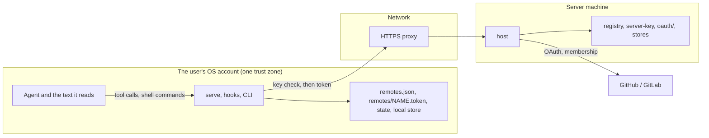

# 09 Security

The threat model for accounts, server identity and switching: what is
worth protecting, who might attack it, how, what the design does about
it, and what it leaves out on purpose.

The mechanisms are in [03-identity-and-auth.md](03-identity-and-auth.md)
and [05-remotes-and-switching.md](05-remotes-and-switching.md);
confirmation and approval are in
[06-confirmation-and-approval.md](06-confirmation-and-approval.md).

## Trust boundaries

- Everything inside the user's OS account trusts everything else there.
  A program running as the user can read the token files and the store
  (#53's limit).
- The network is untrusted, the proxy included: the server key proves
  the server end to end (#58).
- The server trusts a request only by its client token, and a person only
  by a provider-verified numeric id.
- A provider is trusted to say who a person is and whether they're a
  member, and nothing more.

## Assets

| Asset | Where | Why it matters |
|---|---|---|
| Memories | each store | the user's preferences, decisions and context; rules from them drive the agent |
| Rules in the instruction files | the client's files | applied in every session; a wrong one steers the agent |
| Client tokens | `remotes/<name>.token`; hashes in the registry | access to one user's memories on one server |
| Server key | `<data>/server-key` | the server's identity to every client |
| Provider credentials | `<data>/oauth/` | act as the server's app at GitHub or GitLab, including org membership reads |
| The registry | `<data>/accounts.sqlite3` | who may use the server, whose store is whose, which tokens are valid |
| Key pins | `remotes.json` | the client's memory of which server is which |

## Actors

- **A network attacker:** can intercept, redirect or replay traffic, buy
  a lapsed domain, or run a TLS-intercepting proxy.
- **A malicious or mistaken server:** a server the user didn't mean to
  use, or a real one whose operator replaced its key.
- **Another user of the same server:** signed in, with their own store.
- **A former member:** someone who left an org or group that an allow
  rule names.
- **Text the agent reads:** a repository file, a web page, a tool result
  or an import that asks the agent to act.
- **The agent itself, unprompted:** running a command the user didn't ask
  for.
- **A program running as the user on purpose:** malware or a tool with the
  user's file access.
- **Someone with a lost or stolen machine**, or a copy of a token file.

## Threats and mitigations

| # | Threat | Mitigation | Issue |
|---|---|---|---|
| T1 | A mistyped or phished URL, a lapsed domain, or a TLS-intercepting proxy gets a client's token | the client checks the server's key before sending any token, and refuses a mismatch with nothing sent | #58 |
| T2 | A relay at another address passes on a real server's proof | the URL used is inside the signed statement, and the server signs only for its own URLs | #58 |
| T3 | A rollback or a forged "no key" answer skips the check | once a key has been seen, its absence is a mismatch | #58 |
| T4 | A compromised server key | `host key rotate --no-chain` makes every client see a mismatch; the user re-pins only after checking the fingerprint with the operator | #58 |
| T5 | One machine's token leaks or the machine is lost | per-machine tokens, revoked alone by name; revocation is live; 90 days unused expires a token | #48 |
| T6 | A token lands in a tool's output, a log or an agent's context | `host token add` writes to `--out` or a terminal only; tokens never appear in errors, hook output or logs (a test greps for one); the skill says an agent never reads a token file | #48 |
| T7 | A token sent to the wrong server during a switch | one token per remote, chosen by remote name; the key check for that remote's pin comes first | #60, #61 |
| T8 | A switch mixes two servers inside a session, or leaves one server's rules under another | sessions keep the server they started on; the rules block is cleared, then filled from the target with a header naming the source | #61 |
| T9 | The agent switches servers or accounts, or trusts a new key, on its own or because text told it to | no `--yes`; a terminal or the user's own next prompt, typed exactly, confirms; every switch is announced at the next session start with the command to undo it | #61, #62 |
| T10 | A rollback brings back a retired shared token | `retire-shared` replaces the file's token with an unknown one | #48 |
| T11 | A restored memory store brings back revoked tokens or removed users | tokens and users live in the registry, outside every store; restoring the registry revokes every token | #59, #63 |
| T12 | Another user of the server reads or writes your memories | a token resolves to one user and that user's store; no code derives a holder from a path; a test checks two users never cross-read | #63 |
| T13 | A former member keeps access | membership re-checked hourly on use, daily for inactive users, at once by webhook, with a 24-hour grace on provider outages; without the operator's credential, doctor and `host allow add` warn | #66 |
| T14 | Account takeover by linking on email | identities link only by signing in to both; never by email | #67 |
| T15 | Someone joins with a stolen invite | single-use, expiring invites, stored as a hash; the secret sits after `#`; the link carries the key, and the client still shows the host and fingerprint | #68 |
| T16 | A device-code phishing page gets the user to approve someone else's sign-in | the approval page names the client, the provider and when it started; codes expire; each new sign-in is announced on the user's other machines | #64 |
| T17 | OAuth redirect manipulation behind a proxy | redirect URIs come only from `--public-url`, never from `Host` or `X-Forwarded-*`; PKCE and `state` | #64 |
| T18 | Flooding the unauthenticated sign-in endpoint | pending sign-ins per address bounded by a named constant, `slow_down` beyond it, kept in memory and expiring after 15 minutes | #64 |
| T19 | A forged provider webhook removes or restores access | `X-Hub-Signature-256` for GitHub and `X-Gitlab-Token` for GitLab; unverified events are ignored | #66 |
| T20 | An import of someone else's export adds their rules to your account | the export's `source` field is shown in the import preview when it differs | #69 |
| T21 | A text the agent read becomes a rule | `user_confirmed` limits what it proves (#40); new rules shown at session start (#42); stronger options are #53's decision | #53 |
| T22 | An uninstalled machine leaves working tokens | uninstall revokes each reachable remote's token and lists what it left | #71 |
| T23 | A provider token kept by the server is stolen | the user's provider token is discarded at sign-in; only the operator's own credentials are kept, owner-only in `<data>/oauth/` | #64, #66 |
| T24 | A pending confirmation is applied by something other than the user | the whole trimmed prompt must equal the phrase; it expires after `CONFIRMATION_EXPIRY`; it's used once; prompts the client marks as not the user's are ignored | #62 |

## What the design leaves out

- **A program running as the user that sets out to act as the user.** It
  can read the token files, edit `remotes.json` or the store directly, and
  run the CLI. No scheme short of operating-system approval stops it
  (#53, O5). The design makes such changes visible (switch notices,
  `remote-log`, new-sign-in notices) but can't prevent them. #62's docs
  state this limit.
- **A compromised server.** A server can read every store it holds. Users
  of a server trust its operator with their memories; per-user stores
  separate users from each other, not from the operator.
- **Encryption at rest.** The stores, the registry and the token files
  rely on the operating system's permissions and disk encryption (#49);
  the design adds no encryption of its own.
- **The provider itself.** A GitHub or GitLab account takeover is a
  takeover of the identities linked to it.
- **Denial of service beyond sign-in flooding.** Rate limits on the MCP
  endpoints are the proxy's job.
- **Prompts a client can't tell apart from the user's.** Where a client
  doesn't mark queued or automated prompts, #62's phrase could come from
  one; the docs say which clients can tell them apart.

## Checks the tests must keep

- No error path, hook output or log contains a token (#48).
- A key mismatch sends no token, on every path that sends one: `serve`,
  each hook, `login`, the `remote` commands, export and import (#58).
- A relay at another URL fails the check (#58).
- Two users routed to two stores never read each other's memories (#63).
- A restored memory store leaves the registry alone; a restored registry
  revokes every token (#59, #63).
- A phrase inside a longer message, an expired request, a wrong phrase
  and a reused phrase are all refused (#62).
- `state` and PKCE are checked (#64).

## Open points

1. **The pending confirmation holds a live token.** For `login` without a
   terminal, #62 keeps the new token in `pending-confirmation` until the
   phrase or expiry, and revokes it on expiry. The file is owner-only,
   like the token files. Edit #62 to say the file is written through
   `src/private.rs` and deleted, not just emptied, once used.
2. **The key check's cache.** #58 allows caching the check for the
   session, keyed by session id, if it's too slow for `PROMPT_LIMIT`. A
   key changed mid-session would then be seen only at the next session.
   That is acceptable, since the session keeps its server anyway (#61);
   edit #58 to say so.
