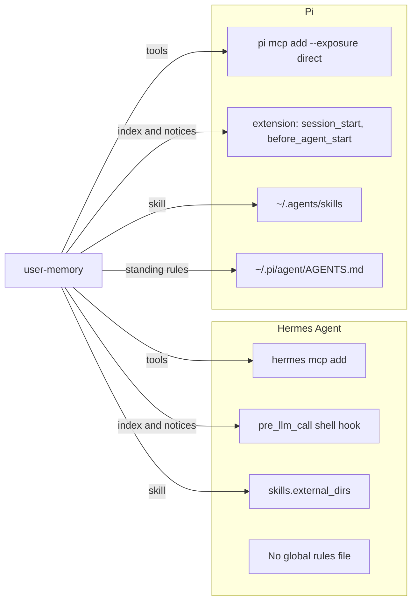
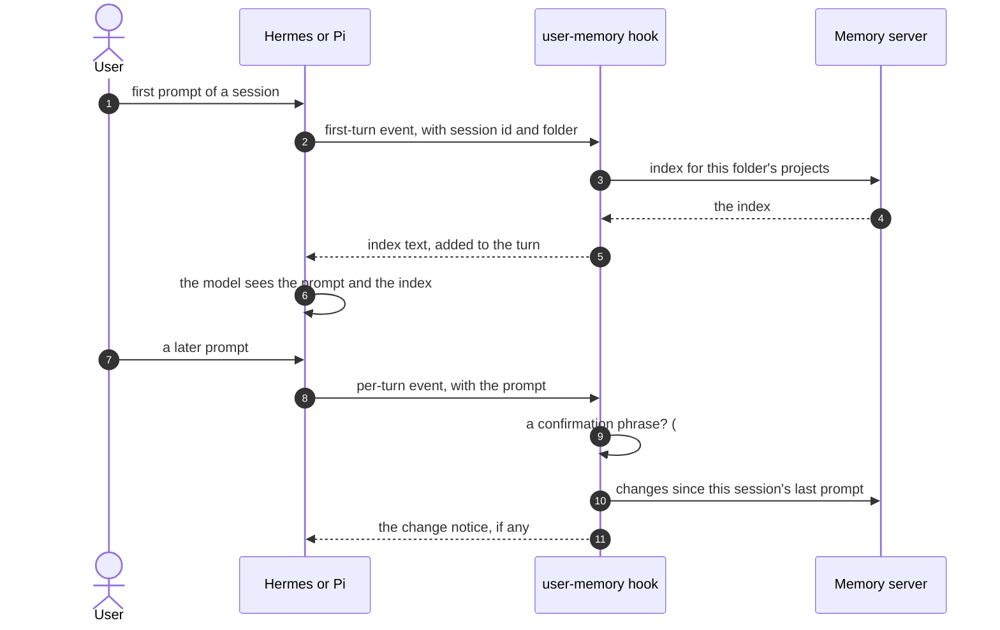

# 10. Agent integrations: Hermes Agent and Pi ([#54](https://github.com/l7aromeo/user-memory/issues/54))

user-memory sets itself up for Claude Code and Codex. [#54](https://github.com/l7aromeo/user-memory/issues/54) asks what
supporting another MCP app takes, and what must be found out first for
Hermes Agent and Pi. It commits to no design. This file answers most of
[#54](https://github.com/l7aromeo/user-memory/issues/54)'s questions from each app's own docs and help output (Hermes Agent
v0.22.5, Pi 1.4.0, read 2026-11-05), and sketches the design the follow-up
issue would hold. What still needs a trial is listed at the end.

## 1. What supporting an app involves

Memory works because seven parts know the app. Today:

| Part | Claude Code | Codex |
|---|---|---|
| Detection | `claude` on `PATH` | `codex` on `PATH` |
| MCP registration | `claude mcp add --scope user` | `codex mcp add` |
| Standing rules | A whole file user-memory owns, `~/.claude/rules/user-memory.md` | A marked block in `~/.codex/AGENTS.md` |
| Session hooks | SessionStart and UserPromptSubmit in the user hook file | The same two events in Codex's hooks, with trust that doctor reports |
| Origin prefix | `claude:session/` | `codex:thread/` |
| Skill | Claude Code's skills folder | `~/.agents/skills/user-memory` |
| Uninstall and doctor | Each part removed and checked | The same, plus the hook approval line |
| Evaluation | `evals/run.py --client claude` | `evals/run.py --client codex` |

Without hooks, an app still has the tools and the server instructions, but
no index at session start and no notice of changes made elsewhere.

## 2. What the apps provide

### 2.1 Hermes Agent

| Part | What Hermes offers | Fit |
|---|---|---|
| Registration | `hermes mcp add <name> --command <cmd> --args … --env KEY=VALUE`; `hermes mcp list`, `hermes mcp test`. | Through its CLI, as for the others. |
| Server instructions | No sign that its MCP client passes the server's `instructions` to the model; its MCP code scans tool descriptions for prompt-override phrases. | Assume not passed until a trial shows otherwise. The rules and the index must carry the guidance. |
| Standing rules | Context files are project-local (`.hermes.md`, `AGENTS.md`, `CLAUDE.md`, from the working folder). The only global file is `SOUL.md`, the agent's personality, loaded from `HERMES_HOME`. | No global rules file to own. The rules reach the model through the index at the first turn instead (below). |
| Hooks | Shell hooks declared under `hooks:` in `~/.hermes/config.yaml`, run per event with a JSON payload on stdin (`session_id`, `cwd`, `profile`, and event fields in `extra`). `pre_llm_call` runs once per turn, and returning `{"context": …}` appends text to the user's message; its `extra` carries `user_message` and `is_first_turn`. `on_session_start` is an observer: its return is ignored. Default timeout 60 s, capped at 300. | Session start becomes `pre_llm_call` with `is_first_turn`; prompt submit becomes every other `pre_llm_call`. The index is appended to the first user message rather than placed before it. |
| Hook consent | A first-use prompt per (event, command) pair, kept in `~/.hermes/shell-hooks-allowlist.json`; `hermes hooks list` shows consent status. | doctor reads `hermes hooks list`, as it reports Codex's trust. |
| Adding hooks | `hermes config set` exists; whether it can add a list entry under `hooks:` is unconfirmed. | If not, setup would edit `config.yaml`, which [#54](https://github.com/l7aromeo/user-memory/issues/54)'s rule (the app's CLI, never its file) forbids. See open point 1. |
| Skill | Its own skills folder, plus `skills.external_dirs` in `config.yaml`, which can list `~/.agents/skills`. | One config value, then the shared skill folder. |
| Competing memory | Built-in `MEMORY.md` and `USER.md`, always active; external memory-provider plugins through `hermes memory setup`. | The index's header and the rules must steer it to user-memory, as the server instructions do for Claude Code's auto memory. |
| Profiles | Several isolated Hermes homes; each hook payload names its `profile`. | Setup writes to the default profile; others are listed by doctor. |
| Session id | `session_id` in every payload. | Origin prefix `hermes:session/`. |

### 2.2 Pi

| Part | What Pi offers | Fit |
|---|---|---|
| Registration | `pi mcp add <server> [--env KEY=VALUE] [--exposure MODE] [--description TEXT] -- <command> [args]`, written to `~/.pi/agent/mcp.json`; `pi mcp list --json` reports state, tools and errors. | Through its CLI. |
| Exposure | `codemode` (the default) hides tools from the model unless a script finds them; `deferred` waits for a tool search; `direct` declares them like built-in tools. | `direct`: ten small tools that must be called at the start of every task. |
| Server instructions | Only the first line of the server's instructions, or `--description`, lists the server in the system prompt. The full text is reachable only through codemode's `describeNamespace()`. | The full guidance doesn't reach the model. The rules file and the index must carry it. |
| Standing rules | `~/.pi/agent/AGENTS.md` (or `AGENTS.override.md`, `CLAUDE.md`) applies across working folders. `APPEND_SYSTEM.md` adds to the system prompt. | A marked block in `~/.pi/agent/AGENTS.md`, as for Codex. |
| Hooks | No hooks command. Extensions, TypeScript files in `~/.pi/agent/extensions/`, get `session_start` and `before_agent_start`. `before_agent_start` sees the prompt (`messageType` `"user"`) and can add a message to the run. | A small owned extension, `~/.pi/agent/extensions/user-memory.ts`, that runs `user-memory session-start --client pi` and the prompt hook, and adds their output. |
| Skill | User skills in `~/.pi/agent/skills/`, and the Agent Skills locations `~/.agents/skills/` and `.agents/skills/`. | The shared skill folder works with no change. |
| Competing memory | None found in its docs. | Nothing to steer away from. |
| Session id | Session UUIDs (`--session`, `--session-id`). | Origin prefix `pi:session/`. |

## 3. The design the follow-up issue would hold

### 3.1 Naming the apps

- `--client` takes a list: `--client claude,codex,pi`. `auto` keeps
  meaning "every app found on `PATH`".
- `both` keeps working as a deprecated alias for `claude,codex` for at
  least one minor release, as [#54](https://github.com/l7aromeo/user-memory/issues/54) requires, and prints a deprecation note.
- Saved settings store the list, so a third app needs no new value.
- `session-start --client` and the hooks take `hermes` and `pi`.

### 3.2 Per app

| Part | Hermes Agent | Pi |
|---|---|---|
| Detection | `hermes` on `PATH` | `pi` on `PATH` |
| Registration | `hermes mcp add user-memory --command … --env …` | `pi mcp add user-memory --exposure direct --description … -- …` |
| Standing rules | None; the first-turn index carries the rules section | Marked block in `~/.pi/agent/AGENTS.md` |
| Index at session start | `pre_llm_call` hook when `is_first_turn` | The extension's `session_start`, added at the first `before_agent_start` |
| Change notices | `pre_llm_call` on later turns | The extension's `before_agent_start` |
| Confirmation ([#53](https://github.com/l7aromeo/user-memory/issues/53), [#62](https://github.com/l7aromeo/user-memory/issues/62)) | The native dialog from `serve` or the CLI; without a display, the prompt is `extra.user_message` | The native dialog; without a display, the prompt when `messageType` is `"user"` |
| Session's server ([#61](https://github.com/l7aromeo/user-memory/issues/61)) | Keyed by `session_id` | Keyed by the session UUID |
| Skill | `skills.external_dirs` lists `~/.agents/skills` | Already read |
| doctor | Registration, hook consent, the skill directory | Registration and exposure, the extension file, the rules block |
| Uninstall | `hermes mcp remove`, the hook entries, the external dir | `pi mcp remove`, the extension file, the rules block |

### 3.3 Where the index goes

Error paths:

- **The server is unreachable:** the hook prints today's
  `User memory unavailable: …`, and the turn goes on.
- **The hook times out** (Hermes' per-entry timeout, Pi's run budget):
  fail open, as the apps do, and doctor reports the slow hook.
- **Hook consent not given yet** (Hermes): the hook doesn't run; doctor
  says how to approve it, as for Codex.
- **The index arrives after the prompt** (Hermes appends to the user's
  message): the index's header already says to check memory before work,
  so the order doesn't change what the agent should do. A trial confirms
  the agent reads it.

### 3.4 Accounts and switching

Nothing in [05](05-remotes-and-switching.md) or [06](06-confirmation-and-approval.md)
is specific to Claude Code or Codex. Each new app needs:

- its hooks to record the session's server at the first turn ([#61](https://github.com/l7aromeo/user-memory/issues/61));
- nothing for the native dialog, which `serve` and the CLI show
  themselves ([#53](https://github.com/l7aromeo/user-memory/issues/53), [#62](https://github.com/l7aromeo/user-memory/issues/62));
- its prompt passed to the typed-phrase check, for machines without a
  display ([#62](https://github.com/l7aromeo/user-memory/issues/62)), with a note in the docs where the app can't tell a user's
  prompt from an automated one;
- its rules location in the list that `remote use` clears and refills.

## 4. Still to find out, by trial

Each item needs one trial against a throwaway store, before the design
issue is written.

| App | Question |
|---|---|
| Hermes | Does its MCP client pass the server's `instructions` to the model? |
| Hermes | Can `hermes config set` add a `hooks:` entry and a `skills.external_dirs` entry, or does setup have to edit `config.yaml`? |
| Hermes | What does the allowlist record for consent (the command, or its hash), so doctor can match it? |
| Hermes | Do scheduled jobs and gateway automation reach `pre_llm_call` as user messages? |
| Hermes | Does the index appended to the first user message steer the agent away from `MEMORY.md`? |
| Pi | Does `--exposure direct` make the agent call `index` and `read` reliably? |
| Pi | Can an extension add text to the first run from `session_start`, or only from `before_agent_start`? |
| Pi | Can an extension's `pi.sendUserMessage()` be told apart from the user's prompt, for [#62](https://github.com/l7aromeo/user-memory/issues/62)? |
| Pi | How reliably does deepseek-flash follow the rules and the index: one evaluation scenario, "a rule recorded in one session reaches the next", before anything ships. |
| Both | The time a hook may take before the app gives up. |

## Open points

1. **Hermes hooks and the "app's CLI" rule.** [#54](https://github.com/l7aromeo/user-memory/issues/54) records the rule that
   registration goes through the app's CLI, never its configuration file.
   Hermes declares shell hooks only in `config.yaml`, and its `hermes hooks`
   command lists, tests and revokes them but doesn't add them. If
   `hermes config set` can't add a list entry, supporting Hermes means
   either editing `config.yaml` (a rule exception the user must approve) or
   shipping a Hermes plugin. The design issue must pick.
2. **Pi's owned extension.** Writing `~/.pi/agent/extensions/user-memory.ts`
   is a file user-memory owns, as the Claude Code rules file is. It runs
   inside Pi's process. The design issue should say how setup updates it
   and how doctor checks it is unchanged.
3. **`both` as a deprecated alias.** [#54](https://github.com/l7aromeo/user-memory/issues/54) says `both` keeps working for at
   least one minor release. The proposal is a comma-separated list; the
   name of the new form is a public name, so it needs the user's decision
   before it is built.
4. **[#54](https://github.com/l7aromeo/user-memory/issues/54) is a research issue.** This file answers most of its questions
   from the apps' docs. The trial notes in section 4 remain, then a design
   issue per app.
