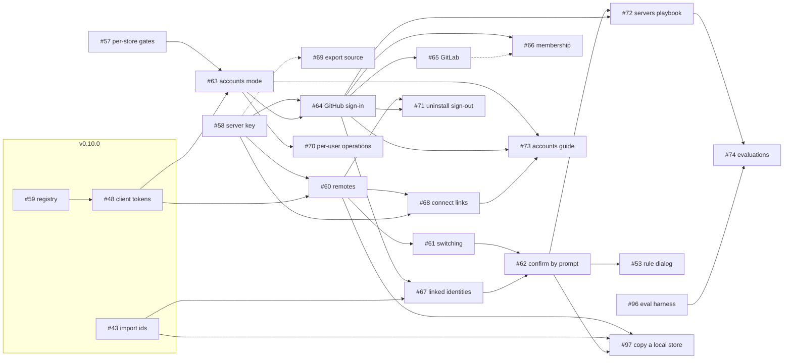

# 12. Build order

How the v0.11.0 issues depend on each other, the order to build them in,
what v0.11.0 holds, and the risks. The dependencies are the issues'
blocked-by links on GitHub as of 2026-11-05, plus the "Depends on" lines in
their bodies where no link exists.

**Decided:** the user chose option A (section 4). The v0.11.0 milestone
holds [#53](https://github.com/l7aromeo/user-memory/issues/53), [#56](https://github.com/l7aromeo/user-memory/issues/56), [#57](https://github.com/l7aromeo/user-memory/issues/57), [#58](https://github.com/l7aromeo/user-memory/issues/58), [#60](https://github.com/l7aromeo/user-memory/issues/60) to [#74](https://github.com/l7aromeo/user-memory/issues/74), [#96](https://github.com/l7aromeo/user-memory/issues/96) and [#97](https://github.com/l7aromeo/user-memory/issues/97): 21 open issues. [#54](https://github.com/l7aromeo/user-memory/issues/54)
stays unscheduled. Blocked-by links added since the first draft:
[#68](https://github.com/l7aromeo/user-memory/issues/68) ← [#58](https://github.com/l7aromeo/user-memory/issues/58), [#73](https://github.com/l7aromeo/user-memory/issues/73) ← [#63](https://github.com/l7aromeo/user-memory/issues/63), [#62](https://github.com/l7aromeo/user-memory/issues/62) ← [#67](https://github.com/l7aromeo/user-memory/issues/67), [#53](https://github.com/l7aromeo/user-memory/issues/53) ← [#62](https://github.com/l7aromeo/user-memory/issues/62), [#74](https://github.com/l7aromeo/user-memory/issues/74) ← [#96](https://github.com/l7aromeo/user-memory/issues/96), and [#97](https://github.com/l7aromeo/user-memory/issues/97) ← [#60](https://github.com/l7aromeo/user-memory/issues/60),
[#43](https://github.com/l7aromeo/user-memory/issues/43) and [#62](https://github.com/l7aromeo/user-memory/issues/62).

The user also decided how confirmation works ([06](06-confirmation-and-approval.md)):
one native confirmation, the terminal or a dialog, for rules ([#53](https://github.com/l7aromeo/user-memory/issues/53)) and
sensitive commands ([#62](https://github.com/l7aromeo/user-memory/issues/62)), with the typed phrase only where no display can
show a dialog. Approval codes are dropped. [#96](https://github.com/l7aromeo/user-memory/issues/96) (the evaluation harness)
and [#97](https://github.com/l7aromeo/user-memory/issues/97) (copying a local store into a server account) are new.

## 1. Before v0.11: what v0.10.0 must deliver

| v0.10.0 issue | What this design uses |
|---|---|
| [#59](https://github.com/l7aromeo/user-memory/issues/59) | The registry, `<data>/accounts.sqlite3`, with `client_tokens` and `settings`; its own migrations. |
| [#48](https://github.com/l7aromeo/user-memory/issues/48) | `umt_` client tokens, read and write scopes, `host token`, `retire-shared`, the 401 descriptions. |
| [#39](https://github.com/l7aromeo/user-memory/issues/39) | Memory history, which [#42](https://github.com/l7aromeo/user-memory/issues/42) uses for the client. |
| [#42](https://github.com/l7aromeo/user-memory/issues/42) | New rules at session start: [#53](https://github.com/l7aromeo/user-memory/issues/53)'s option O2. |
| [#43](https://github.com/l7aromeo/user-memory/issues/43) | Import ids and `forget --import`, which `account merge` uses ([#67](https://github.com/l7aromeo/user-memory/issues/67)). |

All of v0.10.0 is still open. Nothing below starts before [#48](https://github.com/l7aromeo/user-memory/issues/48) and [#59](https://github.com/l7aromeo/user-memory/issues/59)
land; [#67](https://github.com/l7aromeo/user-memory/issues/67) also waits for [#43](https://github.com/l7aromeo/user-memory/issues/43).

## 2. The dependency graph

Solid arrows are blocked-by links. Dashed ones are "Depends on" lines with
no link:

- **[#69](https://github.com/l7aromeo/user-memory/issues/69) on [#58](https://github.com/l7aromeo/user-memory/issues/58):** for the fingerprint. Before [#58](https://github.com/l7aromeo/user-memory/issues/58) it uses the store's
  identity hash, so it can land at any time.
- **[#66](https://github.com/l7aromeo/user-memory/issues/66) on [#65](https://github.com/l7aromeo/user-memory/issues/65):** for GitLab membership.

[#53](https://github.com/l7aromeo/user-memory/issues/53) comes after [#62](https://github.com/l7aromeo/user-memory/issues/62), whose native dialog it shares. [#54](https://github.com/l7aromeo/user-memory/issues/54) (research) is
unscheduled and blocks nothing.

## 3. Phases

Each phase holds the issues whose blockers are all in earlier phases.
Within a phase, the issues can be built in parallel. This matches the
order in [#56](https://github.com/l7aromeo/user-memory/issues/56).

| Phase | Issues | What it builds | Can start when |
|---|---|---|---|
| 1 | [#57](https://github.com/l7aromeo/user-memory/issues/57), [#58](https://github.com/l7aromeo/user-memory/issues/58) | Per-store gates, connections and vector cache; the server key and pin | v0.10.0's [#48](https://github.com/l7aromeo/user-memory/issues/48) and [#59](https://github.com/l7aromeo/user-memory/issues/59) have landed (for [#58](https://github.com/l7aromeo/user-memory/issues/58)'s endpoint beside them) |
| any | [#69](https://github.com/l7aromeo/user-memory/issues/69) | The export's `source` field | Any time; it uses [#58](https://github.com/l7aromeo/user-memory/issues/58)'s fingerprint once that lands |
| 2 | [#60](https://github.com/l7aromeo/user-memory/issues/60), [#63](https://github.com/l7aromeo/user-memory/issues/63) | Remotes on the client; accounts mode, per-user stores, allow rules | [#58](https://github.com/l7aromeo/user-memory/issues/58) and [#48](https://github.com/l7aromeo/user-memory/issues/48) ([#60](https://github.com/l7aromeo/user-memory/issues/60)); [#57](https://github.com/l7aromeo/user-memory/issues/57) and [#48](https://github.com/l7aromeo/user-memory/issues/48) ([#63](https://github.com/l7aromeo/user-memory/issues/63)) |
| 3 | [#61](https://github.com/l7aromeo/user-memory/issues/61), [#64](https://github.com/l7aromeo/user-memory/issues/64), [#68](https://github.com/l7aromeo/user-memory/issues/68), [#70](https://github.com/l7aromeo/user-memory/issues/70) | Switching; GitHub sign-in; connect links; per-user operations | [#60](https://github.com/l7aromeo/user-memory/issues/60) ([#61](https://github.com/l7aromeo/user-memory/issues/61), [#68](https://github.com/l7aromeo/user-memory/issues/68)); [#58](https://github.com/l7aromeo/user-memory/issues/58) and [#63](https://github.com/l7aromeo/user-memory/issues/63) ([#64](https://github.com/l7aromeo/user-memory/issues/64)); [#63](https://github.com/l7aromeo/user-memory/issues/63) ([#70](https://github.com/l7aromeo/user-memory/issues/70)) |
| 4 | [#65](https://github.com/l7aromeo/user-memory/issues/65), [#66](https://github.com/l7aromeo/user-memory/issues/66), [#67](https://github.com/l7aromeo/user-memory/issues/67), [#71](https://github.com/l7aromeo/user-memory/issues/71), [#73](https://github.com/l7aromeo/user-memory/issues/73) | GitLab; membership; linked identities; uninstall sign-out; the accounts guide | [#64](https://github.com/l7aromeo/user-memory/issues/64) ([#65](https://github.com/l7aromeo/user-memory/issues/65), [#66](https://github.com/l7aromeo/user-memory/issues/66), [#71](https://github.com/l7aromeo/user-memory/issues/71) with [#60](https://github.com/l7aromeo/user-memory/issues/60)); [#64](https://github.com/l7aromeo/user-memory/issues/64) and [#43](https://github.com/l7aromeo/user-memory/issues/43) ([#67](https://github.com/l7aromeo/user-memory/issues/67)); [#63](https://github.com/l7aromeo/user-memory/issues/63), [#64](https://github.com/l7aromeo/user-memory/issues/64) and [#68](https://github.com/l7aromeo/user-memory/issues/68) ([#73](https://github.com/l7aromeo/user-memory/issues/73)) |
| 5 | [#62](https://github.com/l7aromeo/user-memory/issues/62) | Confirmation by prompt, with every phrase | [#61](https://github.com/l7aromeo/user-memory/issues/61) and [#67](https://github.com/l7aromeo/user-memory/issues/67) |
| 6 | [#72](https://github.com/l7aromeo/user-memory/issues/72), [#53](https://github.com/l7aromeo/user-memory/issues/53), [#97](https://github.com/l7aromeo/user-memory/issues/97) | The servers playbook; the rule dialog; copying a local store | [#62](https://github.com/l7aromeo/user-memory/issues/62) and [#64](https://github.com/l7aromeo/user-memory/issues/64) ([#72](https://github.com/l7aromeo/user-memory/issues/72)); [#62](https://github.com/l7aromeo/user-memory/issues/62) ([#53](https://github.com/l7aromeo/user-memory/issues/53)); [#60](https://github.com/l7aromeo/user-memory/issues/60), [#43](https://github.com/l7aromeo/user-memory/issues/43) and [#62](https://github.com/l7aromeo/user-memory/issues/62) ([#97](https://github.com/l7aromeo/user-memory/issues/97)) |
| 7 | [#74](https://github.com/l7aromeo/user-memory/issues/74) | Evaluations | [#72](https://github.com/l7aromeo/user-memory/issues/72), [#62](https://github.com/l7aromeo/user-memory/issues/62) and [#96](https://github.com/l7aromeo/user-memory/issues/96) |
| any | [#96](https://github.com/l7aromeo/user-memory/issues/96) | The evaluation harness | v0.10.0's [#46](https://github.com/l7aromeo/user-memory/issues/46); each part as the feature it tests lands |
| unscheduled | [#54](https://github.com/l7aromeo/user-memory/issues/54) | Hermes and Pi research | Any time |

With [#62](https://github.com/l7aromeo/user-memory/issues/62) ← [#67](https://github.com/l7aromeo/user-memory/issues/67), [#62](https://github.com/l7aromeo/user-memory/issues/62) lands once, with every phrase, as [#56](https://github.com/l7aromeo/user-memory/issues/56)'s order has it.

## 4. What v0.11.0 holds

Two cuts were weighed. The user chose option A.

### Option A: everything in one release (chosen)

The v0.11.0 milestone holds [#53](https://github.com/l7aromeo/user-memory/issues/53), [#56](https://github.com/l7aromeo/user-memory/issues/56), [#57](https://github.com/l7aromeo/user-memory/issues/57), [#58](https://github.com/l7aromeo/user-memory/issues/58), [#60](https://github.com/l7aromeo/user-memory/issues/60) to [#74](https://github.com/l7aromeo/user-memory/issues/74), [#96](https://github.com/l7aromeo/user-memory/issues/96) and [#97](https://github.com/l7aromeo/user-memory/issues/97):
21 open issues, with [#56](https://github.com/l7aromeo/user-memory/issues/56) as the tracking issue. One upgrade note, one set of docs.
It is the largest release yet: a new public surface (OAuth endpoints,
`remote`, `login`, `account`, `host accounts|users|allow|provider|invite|key`),
and two registry migrations. [#54](https://github.com/l7aromeo/user-memory/issues/54) stays unscheduled.

### Option B: switching first, accounts after (not chosen)

Switching ([#57](https://github.com/l7aromeo/user-memory/issues/57), [#58](https://github.com/l7aromeo/user-memory/issues/58), [#60](https://github.com/l7aromeo/user-memory/issues/60), [#61](https://github.com/l7aromeo/user-memory/issues/61), [#62](https://github.com/l7aromeo/user-memory/issues/62)'s remote phrases, [#68](https://github.com/l7aromeo/user-memory/issues/68), [#69](https://github.com/l7aromeo/user-memory/issues/69)) in v0.11.0,
and accounts ([#63](https://github.com/l7aromeo/user-memory/issues/63) to [#67](https://github.com/l7aromeo/user-memory/issues/67), [#70](https://github.com/l7aromeo/user-memory/issues/70) to [#74](https://github.com/l7aromeo/user-memory/issues/74)) in v0.12.0. It would have shipped
without OAuth first, but left uninstall's sign-out ([#71](https://github.com/l7aromeo/user-memory/issues/71)) and the servers
playbook ([#72](https://github.com/l7aromeo/user-memory/issues/72)) for a second release.

## 5. Risks

| Risk | Where | Mitigation |
|---|---|---|
| The key check is too slow for the prompt hook | [#58](https://github.com/l7aromeo/user-memory/issues/58) | Measure against `PROMPT_LIMIT`; cache per session id, never per process ([#58](https://github.com/l7aromeo/user-memory/issues/58)). |
| A client's prompt hook can't tell the user's prompt from automation | [#62](https://github.com/l7aromeo/user-memory/issues/62) | Check each client when building; the docs say where it can't ([#62](https://github.com/l7aromeo/user-memory/issues/62)). |
| The registration rewrite to `default` breaks a working install | [#60](https://github.com/l7aromeo/user-memory/issues/60) | It runs once, keeps the token file where it is, and is tested through the binary; environment setups keep their priority. |
| Two registry migrations numbered at once | [#63](https://github.com/l7aromeo/user-memory/issues/63), [#68](https://github.com/l7aromeo/user-memory/issues/68) | Each is "the next version after the one in use"; they are numbered when they land, as [#68](https://github.com/l7aromeo/user-memory/issues/68) says. |
| A code path decides a holder from a path | [#63](https://github.com/l7aromeo/user-memory/issues/63) | A test greps that no code does ([#63](https://github.com/l7aromeo/user-memory/issues/63)). |
| Per-store gates slow one store down | [#57](https://github.com/l7aromeo/user-memory/issues/57) | `just search-budget` and `tests/concurrency.rs` on one store, before and after. |
| GitLab device grant support varies by version | [#65](https://github.com/l7aromeo/user-memory/issues/65) | Offer the web way only on an older instance, and say why. |
| GitLab group tokens may need a paid plan on the hosted service | [#66](https://github.com/l7aromeo/user-memory/issues/66) | Confirm before the docs promise it ([#66](https://github.com/l7aromeo/user-memory/issues/66)). |
| An agent learns to type the phrase or handle tokens | [#62](https://github.com/l7aromeo/user-memory/issues/62), [#72](https://github.com/l7aromeo/user-memory/issues/72) | [#74](https://github.com/l7aromeo/user-memory/issues/74)'s evaluations, each with a mutation check ([#96](https://github.com/l7aromeo/user-memory/issues/96)). |
| A dialog can't show where the user is | [#53](https://github.com/l7aromeo/user-memory/issues/53), [#62](https://github.com/l7aromeo/user-memory/issues/62) | Detect a display per OS; fall back to the pending rule or the typed phrase, never to no confirmation. |
| Windows parity | [#60](https://github.com/l7aromeo/user-memory/issues/60), [#62](https://github.com/l7aromeo/user-memory/issues/62), [#71](https://github.com/l7aromeo/user-memory/issues/71) | Owner-only files through `src/private.rs`; the Windows uninstaller does the same as [#71](https://github.com/l7aromeo/user-memory/issues/71) requires. |
| v0.10.0 slips | all | Nothing here starts before [#48](https://github.com/l7aromeo/user-memory/issues/48) and [#59](https://github.com/l7aromeo/user-memory/issues/59); [#57](https://github.com/l7aromeo/user-memory/issues/57) and [#58](https://github.com/l7aromeo/user-memory/issues/58) are the only phase-1 work. |

## 6. Issue map

| Issue | Phase | Release | Blocked by (links) | Main file |
|---|---|---|---|---|
| [#53](https://github.com/l7aromeo/user-memory/issues/53) | 6 | v0.11.0 | [#62](https://github.com/l7aromeo/user-memory/issues/62) | [06](06-confirmation-and-approval.md) |
| [#54](https://github.com/l7aromeo/user-memory/issues/54) | unscheduled | none | none | [10](10-agent-integrations.md) |
| [#56](https://github.com/l7aromeo/user-memory/issues/56) | tracking | v0.11.0 | its sub-issues | [00](00-overview.md) |
| [#57](https://github.com/l7aromeo/user-memory/issues/57) | 1 | v0.11.0 | none | [04](04-accounts-mode.md) |
| [#58](https://github.com/l7aromeo/user-memory/issues/58) | 1 | v0.11.0 | none | [03](03-identity-and-auth.md) |
| [#60](https://github.com/l7aromeo/user-memory/issues/60) | 2 | v0.11.0 | [#58](https://github.com/l7aromeo/user-memory/issues/58), [#48](https://github.com/l7aromeo/user-memory/issues/48) | [05](05-remotes-and-switching.md) |
| [#61](https://github.com/l7aromeo/user-memory/issues/61) | 3 | v0.11.0 | [#60](https://github.com/l7aromeo/user-memory/issues/60) | [05](05-remotes-and-switching.md) |
| [#62](https://github.com/l7aromeo/user-memory/issues/62) | 5 | v0.11.0 | [#61](https://github.com/l7aromeo/user-memory/issues/61), [#67](https://github.com/l7aromeo/user-memory/issues/67) | [06](06-confirmation-and-approval.md) |
| [#63](https://github.com/l7aromeo/user-memory/issues/63) | 2 | v0.11.0 | [#57](https://github.com/l7aromeo/user-memory/issues/57), [#48](https://github.com/l7aromeo/user-memory/issues/48) | [04](04-accounts-mode.md) |
| [#64](https://github.com/l7aromeo/user-memory/issues/64) | 3 | v0.11.0 | [#58](https://github.com/l7aromeo/user-memory/issues/58), [#63](https://github.com/l7aromeo/user-memory/issues/63) | [03](03-identity-and-auth.md) |
| [#65](https://github.com/l7aromeo/user-memory/issues/65) | 4 | v0.11.0 | [#64](https://github.com/l7aromeo/user-memory/issues/64) | [03](03-identity-and-auth.md) |
| [#66](https://github.com/l7aromeo/user-memory/issues/66) | 4 | v0.11.0 | [#64](https://github.com/l7aromeo/user-memory/issues/64) | [03](03-identity-and-auth.md) |
| [#67](https://github.com/l7aromeo/user-memory/issues/67) | 4 | v0.11.0 | [#64](https://github.com/l7aromeo/user-memory/issues/64), [#43](https://github.com/l7aromeo/user-memory/issues/43) | [03](03-identity-and-auth.md) |
| [#68](https://github.com/l7aromeo/user-memory/issues/68) | 3 | v0.11.0 | [#60](https://github.com/l7aromeo/user-memory/issues/60), [#58](https://github.com/l7aromeo/user-memory/issues/58) | [05](05-remotes-and-switching.md) |
| [#69](https://github.com/l7aromeo/user-memory/issues/69) | any | v0.11.0 | none | [04](04-accounts-mode.md) |
| [#70](https://github.com/l7aromeo/user-memory/issues/70) | 3 | v0.11.0 | [#63](https://github.com/l7aromeo/user-memory/issues/63) | [04](04-accounts-mode.md) |
| [#71](https://github.com/l7aromeo/user-memory/issues/71) | 4 | v0.11.0 | [#60](https://github.com/l7aromeo/user-memory/issues/60), [#64](https://github.com/l7aromeo/user-memory/issues/64) | [05](05-remotes-and-switching.md) |
| [#72](https://github.com/l7aromeo/user-memory/issues/72) | 6 | v0.11.0 | [#62](https://github.com/l7aromeo/user-memory/issues/62), [#64](https://github.com/l7aromeo/user-memory/issues/64) | [11](11-skill-docs-evals.md) |
| [#73](https://github.com/l7aromeo/user-memory/issues/73) | 4 | v0.11.0 | [#64](https://github.com/l7aromeo/user-memory/issues/64), [#68](https://github.com/l7aromeo/user-memory/issues/68), [#63](https://github.com/l7aromeo/user-memory/issues/63) | [11](11-skill-docs-evals.md) |
| [#74](https://github.com/l7aromeo/user-memory/issues/74) | 7 | v0.11.0 | [#72](https://github.com/l7aromeo/user-memory/issues/72), [#96](https://github.com/l7aromeo/user-memory/issues/96) | [11](11-skill-docs-evals.md) |
| [#96](https://github.com/l7aromeo/user-memory/issues/96) | any | v0.11.0 | none | [11](11-skill-docs-evals.md) |
| [#97](https://github.com/l7aromeo/user-memory/issues/97) | 6 | v0.11.0 | [#60](https://github.com/l7aromeo/user-memory/issues/60), [#43](https://github.com/l7aromeo/user-memory/issues/43), [#62](https://github.com/l7aromeo/user-memory/issues/62) | [11](11-skill-docs-evals.md) |

## 7. Open points

Settled by the user's decisions (2026-11-05), and now in the issues:

- **The release cut:** option A, with [#96](https://github.com/l7aromeo/user-memory/issues/96) and [#97](https://github.com/l7aromeo/user-memory/issues/97) added.
- **The links:** [#68](https://github.com/l7aromeo/user-memory/issues/68) ← [#58](https://github.com/l7aromeo/user-memory/issues/58), [#73](https://github.com/l7aromeo/user-memory/issues/73) ← [#63](https://github.com/l7aromeo/user-memory/issues/63), [#62](https://github.com/l7aromeo/user-memory/issues/62) ← [#67](https://github.com/l7aromeo/user-memory/issues/67), [#53](https://github.com/l7aromeo/user-memory/issues/53) ← [#62](https://github.com/l7aromeo/user-memory/issues/62), [#74](https://github.com/l7aromeo/user-memory/issues/74) ← [#96](https://github.com/l7aromeo/user-memory/issues/96),
  [#97](https://github.com/l7aromeo/user-memory/issues/97) ← [#60](https://github.com/l7aromeo/user-memory/issues/60), [#43](https://github.com/l7aromeo/user-memory/issues/43) and [#62](https://github.com/l7aromeo/user-memory/issues/62).
- **Confirmation:** one native confirmation for rules and sensitive
  commands; the typed phrase only without a display; approval codes
  dropped ([#53](https://github.com/l7aromeo/user-memory/issues/53), [#62](https://github.com/l7aromeo/user-memory/issues/62); [06](06-confirmation-and-approval.md)).
- **Remotes:** `remote trust` and `remote set-token` in [#60](https://github.com/l7aromeo/user-memory/issues/60); remote names
  are lowercase letters, digits and `-`; the migration pins at first
  contact; the `serve` and SessionStart window is closed ([#61](https://github.com/l7aromeo/user-memory/issues/61)).
- **The self-revoke endpoint:** `DELETE /auth/token` belongs to [#48](https://github.com/l7aromeo/user-memory/issues/48), so
  [#60](https://github.com/l7aromeo/user-memory/issues/60) and [#71](https://github.com/l7aromeo/user-memory/issues/71) use it before accounts exist.
- **Every file's other open points:** applied as proposed. Each file's
  "Open points" section says where each went.

Still open:

1. **[#54](https://github.com/l7aromeo/user-memory/issues/54)** stays unscheduled: the Hermes Agent and Pi questions in
   [10](10-agent-integrations.md) wait for trials and a design issue per
   app.
2. **[#72](https://github.com/l7aromeo/user-memory/issues/72)'s "move memories" note** ([11](11-skill-docs-evals.md) open
   point 3): the playbook should say an export on a client is written on
   that machine, and use [#97](https://github.com/l7aromeo/user-memory/issues/97)'s `remote copy` for a local store. [#72](https://github.com/l7aromeo/user-memory/issues/72) has no
   owner yet.
3. **[#67](https://github.com/l7aromeo/user-memory/issues/67)'s confirmation line** still says "at a terminal or by [#62](https://github.com/l7aromeo/user-memory/issues/62)'s
   phrase"; it should say "through [#62](https://github.com/l7aromeo/user-memory/issues/62)'s confirmation", as [#60](https://github.com/l7aromeo/user-memory/issues/60), [#61](https://github.com/l7aromeo/user-memory/issues/61) and
   [#64](https://github.com/l7aromeo/user-memory/issues/64) now do.
