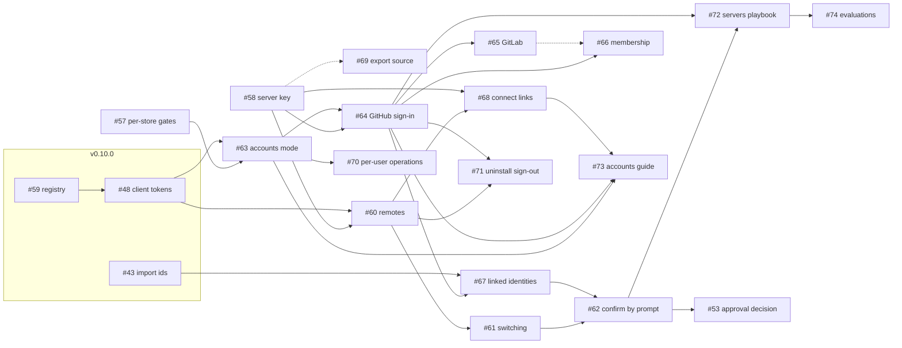

# 12. Build order

How the open issues depend on each other, the order to build them in,
what v0.11.0 holds, and the risks. The dependencies are the issues'
blocked-by links on GitHub as of 2026-11-05, plus the "Depends on" lines in
their bodies where no link exists.

**Decided:** the user chose option A (section 4). The v0.11.0 milestone
holds #53, #56, #57, #58 and #60 to #74: 19 open issues. #54 stays
unscheduled. Four blocked-by links were added: #68 ← #58, #73 ← #63,
#62 ← #67 and #53 ← #62.

## 1. Before v0.11: what v0.10.0 must deliver

| v0.10.0 issue | What this design uses |
|---|---|
| #59 | The registry, `<data>/accounts.sqlite3`, with `client_tokens` and `settings`; its own migrations. |
| #48 | `umt_` client tokens, read and write scopes, `host token`, `retire-shared`, the 401 descriptions. |
| #39 | Memory history, which #42 uses for the client. |
| #42 | New rules at session start: #53's option O2. |
| #43 | Import ids and `forget --import`, which `account merge` uses (#67). |

All of v0.10.0 is still open. Nothing below starts before #48 and #59
land; #67 also waits for #43.

## 2. The dependency graph

Solid arrows are blocked-by links. Dashed ones are "Depends on" lines with
no link:

- **#69 on #58:** for the fingerprint. Before #58 it uses the store's
  identity hash, so it can land at any time.
- **#66 on #65:** for GitLab membership.

#53 is the approval decision, now after #62, whose prompt mechanism its
option O3 would reuse. #54 (research) is unscheduled and blocks nothing.

## 3. Phases

Each phase holds the issues whose blockers are all in earlier phases.
Within a phase, the issues can be built in parallel. This matches the
order in #56.

| Phase | Issues | What it builds | Can start when |
|---|---|---|---|
| 1 | #57, #58 | Per-store gates, connections and vector cache; the server key and pin | v0.10.0's #48 and #59 have landed (for #58's endpoint beside them) |
| any | #69 | The export's `source` field | Any time; it uses #58's fingerprint once that lands |
| 2 | #60, #63 | Remotes on the client; accounts mode, per-user stores, allow rules | #58 and #48 (#60); #57 and #48 (#63) |
| 3 | #61, #64, #68, #70 | Switching; GitHub sign-in; connect links; per-user operations | #60 (#61, #68); #58 and #63 (#64); #63 (#70) |
| 4 | #65, #66, #67, #71, #73 | GitLab; membership; linked identities; uninstall sign-out; the accounts guide | #64 (#65, #66, #71 with #60); #64 and #43 (#67); #63, #64 and #68 (#73) |
| 5 | #62 | Confirmation by prompt, with every phrase | #61 and #67 |
| 6 | #72, #53 | The servers playbook; the approval decision | #62 and #64 (#72); #62 (#53) |
| 7 | #74 | Evaluations | #72 and #62 |
| unscheduled | #54 | Hermes and Pi research | Any time |

With #62 ← #67, #62 lands once, with every phrase, as #56's order has it.

## 4. What v0.11.0 holds

Two cuts were weighed. The user chose option A.

### Option A: everything in one release (chosen)

The v0.11.0 milestone holds #53, #56, #57, #58 and #60 to #74: 19 open
issues, with #56 as the tracking issue. One upgrade note, one set of docs.
It is the largest release yet: a new public surface (OAuth endpoints,
`remote`, `login`, `account`, `host accounts|users|allow|provider|invite|key`),
and two registry migrations. #54 stays unscheduled.

### Option B: switching first, accounts after (not chosen)

Switching (#57, #58, #60, #61, #62's remote phrases, #68, #69) in v0.11.0,
and accounts (#63 to #67, #70 to #74) in v0.12.0. It would have shipped
without OAuth first, but left uninstall's sign-out (#71) and the servers
playbook (#72) for a second release.

## 5. Risks

| Risk | Where | Mitigation |
|---|---|---|
| The key check is too slow for the prompt hook | #58 | Measure against `PROMPT_LIMIT`; cache per session id, never per process (#58). |
| A client's prompt hook can't tell the user's prompt from automation | #62 | Check each client when building; the docs say where it can't (#62). |
| The registration rewrite to `default` breaks a working install | #60 | It runs once, keeps the token file where it is, and is tested through the binary; environment setups keep their priority. |
| Two registry migrations numbered at once | #63, #68 | Each is "the next version after the one in use"; they are numbered when they land, as #68 says. |
| A code path decides a holder from a path | #63 | A test greps that no code does (#63). |
| Per-store gates slow one store down | #57 | `just search-budget` and `tests/concurrency.rs` on one store, before and after. |
| GitLab device grant support varies by version | #65 | Offer the web way only on an older instance, and say why. |
| GitLab group tokens may need a paid plan on the hosted service | #66 | Confirm before the docs promise it (#66). |
| An agent learns to type the phrase or handle tokens | #62, #72 | #74's evaluations, each with a mutation check. |
| Windows parity | #60, #62, #71 | Owner-only files through `src/private.rs`; the Windows uninstaller does the same as #71 requires. |
| v0.10.0 slips | all | Nothing here starts before #48 and #59; #57 and #58 are the only phase-1 work. |

## 6. Issue map

| Issue | Phase | Release | Blocked by (links) | Main file |
|---|---|---|---|---|
| #53 | 6 | v0.11.0 | #62 | [06](06-confirmation-and-approval.md) |
| #54 | unscheduled | none | none | [10](10-agent-integrations.md) |
| #56 | tracking | v0.11.0 | its sub-issues | [00](00-overview.md) |
| #57 | 1 | v0.11.0 | none | [04](04-accounts-mode.md) |
| #58 | 1 | v0.11.0 | none | [03](03-identity-and-auth.md) |
| #60 | 2 | v0.11.0 | #58, #48 | [05](05-remotes-and-switching.md) |
| #61 | 3 | v0.11.0 | #60 | [05](05-remotes-and-switching.md) |
| #62 | 5 | v0.11.0 | #61, #67 | [06](06-confirmation-and-approval.md) |
| #63 | 2 | v0.11.0 | #57, #48 | [04](04-accounts-mode.md) |
| #64 | 3 | v0.11.0 | #58, #63 | [03](03-identity-and-auth.md) |
| #65 | 4 | v0.11.0 | #64 | [03](03-identity-and-auth.md) |
| #66 | 4 | v0.11.0 | #64 | [03](03-identity-and-auth.md) |
| #67 | 4 | v0.11.0 | #64, #43 | [03](03-identity-and-auth.md) |
| #68 | 3 | v0.11.0 | #60, #58 | [05](05-remotes-and-switching.md) |
| #69 | any | v0.11.0 | none | [04](04-accounts-mode.md) |
| #70 | 3 | v0.11.0 | #63 | [04](04-accounts-mode.md) |
| #71 | 4 | v0.11.0 | #60, #64 | [05](05-remotes-and-switching.md) |
| #72 | 6 | v0.11.0 | #62, #64 | [11](11-skill-docs-evals.md) |
| #73 | 4 | v0.11.0 | #64, #68, #63 | [11](11-skill-docs-evals.md) |
| #74 | 7 | v0.11.0 | #72 | [11](11-skill-docs-evals.md) |

## 7. Open points that block scheduling

From this file:

1. **The release cut:** decided, option A.
2. **Missing links:** added (#68 ← #58, #73 ← #63, #62 ← #67, #53 ← #62).
3. **The self-revoke endpoint.** #60's `remote remove` and #71 both use
   `DELETE /auth/token`, which #64 defines. #48 needs a line naming the
   endpoint a machine uses to revoke its own token, so #60 can use it
   before accounts exist. Listed again below, with the shared points.

The rest wait for the user.

From the other files:

- [06](06-confirmation-and-approval.md): who revokes a lapsed `login`
  token; the characters allowed in a remote name; #53's decision.
- [07](07-state-machines.md): the damaged-registry message with accounts
  on.
- [08](08-edge-cases.md): the `login` message for a server older than
  accounts.
- [10](10-agent-integrations.md): Hermes hooks and the "app's CLI" rule;
  the name of the list form that replaces `both`.
- [11](11-skill-docs-evals.md): the evaluation harness work #74 assumes.

- [01](01-architecture.md): #61's stop hook doesn't exist; how `serve`
  finds the session's record.
- [02](02-data-model.md): where membership checks are kept; what `purge`
  does to a user's rows; store and user id shapes; allow rules as one row
  each; `client_tokens.user` for the owner; #39's and #42's references
  after #61; the client migration without a reachable server; the
  registry and #52's checks.
- [03](03-identity-and-auth.md): `remote trust` has no issue; messages
  that name a remote before #60; replacing a remote's token after #48's
  revoked or expired messages; the accounts-on notice for pre-accounts
  client tokens.
- [04](04-accounts-mode.md): backups of every store; the registry's quiet
  and shutdown checks; `enable` with an unknown owner; `disable` and
  `purge` without a terminal; removing the owner; a removed allow rule; a
  registry backup naming a purged store; restoring an older backup; gate
  keys by store id; `source.server` before #58.
- [05](05-remotes-and-switching.md): `remote trust`; replacing a remote's
  token; a remote with no token; the `serve` and SessionStart window;
  `remote use` under an environment override; the rules block on a 401;
  uninstall and a key mismatch; the rules header without accounts.
- [09](09-security.md): the token held in `pending-confirmation`; the key
  check's per-session cache.

Shared across files, and the first to settle:

- **`remote trust`** ([03](03-identity-and-auth.md) 1,
  [05](05-remotes-and-switching.md) 1): needed by #58 and #62, owned by no
  issue. Proposed home: #60.
- **The self-revoke endpoint** (open point 3 above): `remote remove` (#60)
  and uninstall (#71) both revoke this machine's token, but the endpoint,
  `DELETE /auth/token`, is defined by #64. #48 should own it, so #60 can
  use it before accounts exist.
- **The client migration without a reachable server**
  ([02](02-data-model.md) 8, [05](05-remotes-and-switching.md) 3): one
  answer in #60.
